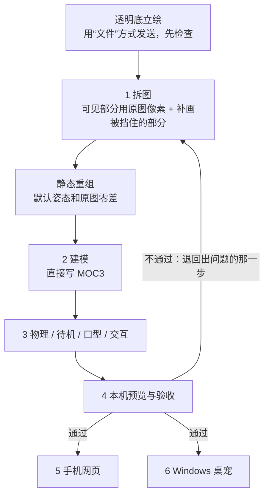

# 教程：从一张图到手机和桌宠

这一篇只讲**怎么做**。每一步都按同样的顺序写：目标、工具、步骤、要抠的细节、验收标准。我们踩过的坑在这里只用一行“注意”带过，完整经过见[踩坑复盘](02-踩坑复盘.md)；怎么给 agent 派活、怎么验收，见[和AI协作](03-和AI协作.md)；参数和常数的速查表见[参考](04-参考.md)。

先解释几个后面反复用到的词：

- **alpha**：图片里每个像素的透明度，0 表示全透明，255 表示完全不透明。
- **MOC3**：Live2D 运行时读取的模型二进制文件，里面装着网格、参数和形变。
- **keyform**：某个参数取某个值时，网格应该长成的样子。运行时在几个 keyform 之间插值，模型就动起来了。
- **Core / Framework**：Core 是 Live2D 官方运行库，负责加载 MOC3、计算网格；Framework 是官方网页框架，负责动作曲线和物理。
- **RAF**：`requestAnimationFrame`，浏览器每一帧回调一次的绘制循环。
- **零差**：两张图逐像素相减，最大差值为 0。



---

## 0 准备与原图检查

**目标**：拿到没压缩、带透明通道的原图，记下它的 SHA-256，之后任何步骤都不许改它。

**工具**
- Python 3 虚拟环境，用到这些包：attrs 26.1.0、numpy 2.5.4、opencv-python-headless 5.0.0.93、pillow 13.0.0、psd-tools 1.25.0。
- `py-moc3` 序列化器（MIT），用随 [fifteen42/live2d-from-art](https://github.com/fifteen42/live2d-from-art) 附带的固定快照。
- Live2D Cubism Core（专有，自己从官网下载；我们验证用的版本是 5.1.0）。
- Cubism Web Framework 5-r.2（固定提交 `e3c4ba18…`），用 esbuild 打包成单文件。
- Node + Playwright（浏览器检查和录屏用）、ffmpeg、`ffprobe` 或 Pillow、`shasum -a 256`。
- 一个图像生成工具，只用来补画被挡住的部分。

**步骤**
1. 请对方用“文件”方式发图（在 Telegram 里是点回形针，再选“文件”），不要选“照片”。
2. 收到后先查四件事：格式是不是 PNG；模式是不是 RGBA；尺寸多大；**alpha 分布**，也就是 alpha 为 0、为 255、介于两者之间的像素各有多少个。
3. 把原图设为只读，把 SHA 写进来源说明，再在测试里加一条“原图不可变”。

**要抠的细节**
- **只确认“是 RGBA、四个角是透明的”还不够。** 我们这张原图是 1086×1448，统计下来：完全透明的像素 504,739 个，alpha 正好是 255 的只有 534 个，其余 1,067,255 个都是中间值，大多落在 252–254 之间（光 253 这一档就有 727,193 个）。也就是说，**人物主体内部本来就不是完全不透明的**。这会影响后面叠层时的透明度和接缝；同时也说明不能随手把内部 alpha 全改成 255。我们最后专门做了一层修正来还原原图的透明度，见[第 2 步的 SourceOpacity](#2-建模直接写-moc3)。
- 原图宽或高低于约 1000px 时，拆出来的虹膜只有十几二十个像素，眼神细节会受限。

> 注意：按“照片”发送的图会被压成黑底 JPG，我们拿这样的图做了两版，都白做了。→ [复盘：原图被压成黑底 JPG](02-踩坑复盘.md#坑1-原图被压成黑底-jpg)

**验收标准**：有 SHA 记录；模式是 RGBA；记下了 alpha 分布；四个角确实是透明的。

---

## 1 拆图

**目标**：把原图拆成可以单独动的部件，产出每个部件的 PNG、坐标、遮挡蒙版和 PSD。**默认姿态拼回去要和原图零差**；那些被挡住、动起来才会露出来的地方，要补画完整。

**工具**：Pillow、NumPy、OpenCV、psd-tools；图像生成工具（只补被挡住的部分）；博主 skill 里关于素材处理的参考文档。

**步骤**
1. **看得见的部分直接用原图像素**，按部件分配。皮肤和细线混在一起的半透明边缘，用“反求 alpha / 前景色”的办法拆开。
2. **只给被挡住的部分补画**：耳根（要画长一些，伸进头发底下）、耳后头皮和后发底、口腔（深色、上牙、舌头）、刘海下面的额头、闭眼时的眼皮、头发后面的衣服。**绝不能拿生成图去替换看得见的脸。**
3. 画布取原图尺寸的 2 倍（我们是 2172×2896），**用整数像素复制放大**，不要用平滑重采样。放大不等于多了细节。
4. 部件清单要细：脸底、脸部光影（单独一层）、脖子、左右耳、眼白、虹膜、高光、上下睫毛、闭眼线、眉毛、口腔/牙/舌、上下唇、多片头发、镜框、衣服各片。我们最终是 65 层。被镜框挡住的侧发，额外做了一片“深度片”，跟同侧发束绑在一起。
5. 把每层的数据写进一份分层清单（字段和例子见[第 7 步](#7-实现流程与示例)）。

**要抠的细节**
- **低透明度的散点会把自动裁切框撑大。** 生成的 PNG 在透明区里常有 alpha 极低的散点，自动裁切会把它们也框进去，比如框进虹膜的边界，一缩放圆形就歪了。正确做法是先找出主体的有效连通区域，再定裁切框，同时保留抗锯齿边缘。**不要只用 `getbbox()`，也不要把半透明像素一刀切掉。**
- **脸部光影层里不能烘进别的部件的影子**，否则镜框一动，脸上会留下一副“幽灵眼镜”。
- **半透明边缘要干净**，不能留下反求 alpha 时产生的灰白闪点。
- **眼白要完整连续，不能有洞；虹膜要完整**：瞳孔是圆的，被上眼睑盖住的那部分也要补全。
- **闭眼补丁要压在刘海下面**，形状沿着眼眶走，不能有直角硬边。
- **闭眼线用原图上睫毛的像素往下弯出来**，保留原来的粗细变化、颜色和收尖。
- **牙齿**画成一条柔和的白色弧带，用极淡的竖线暗示 4–6 颗，不要画成锯齿形的尖牙。
- 左右眼本来就不对称，按各自的样子做，不要做成镜像。
- **默认遮挡蒙版不能烘进纹理里。** 被挡住的部分应该随遮挡物移动而露出来，而不是一个永久的缺口。每个蒙版有自己的 x/y，不一定等于部件的裁切框。
- 眼眶蒙版要保留自己的坐标和完整范围，不能按虹膜 PNG 的大小去裁，也不能跟着虹膜一起动。
- **三件事要分开处理**：
  - 素材保真：始终用整数像素复制，平滑重采样会改动受保护的像素。
  - 隐藏件抗锯齿：只处理动起来才露出的部件。例如我们只给闭眼线的边界做了约 0.9 个原生像素的抗锯齿。
  - 显示缩放：交给渲染器处理，见[第 4 步](#4-本机预览与验收方法)。

> 注意：已经有定稿立绘，就别让 AI 逐件重画，那样会变脸。→ [复盘：逐件重画变脸](02-踩坑复盘.md#坑2-定稿立绘逐件-ai-重画变了脸)
> 注意：修隐藏件时动了看得见的像素，结果越改越坏。→ [复盘：越改越坏](02-踩坑复盘.md#坑3-修隐藏件时动了可见像素越改越坏)

**验收标准**
- 默认拼合图在原生尺寸和 2 倍尺寸下都和原图逐像素相减，**RGBA 最大差为 0**。
- 每种状态（转眼、张嘴、闭眼……）只改动它该改动的区域。
- **把每一层单独铺在灰底上放大看**，不能只看拼合图。默认拼合等于原图，并不说明拆得好。
- **说清楚你比较的是什么。**“原像素分配后的重组”“加了补画之后的合成”“PSD 的合成”是三种不同的结果，要分别报告。PSD 只能证明可以编辑、图层齐全；它的合并预览会受白底预乘和 8 位量化影响，**零差要以 PNG 为准**。
- 最后请人看一眼，判断“是不是他”。

---

## 2 建模（直接写 MOC3）

**目标**：不用 Cubism Editor，直接写出 Core 能加载的 `.moc3`，以及配套的 `model3.json`、纹理、`physics3.json`、`idle.motion3.json`、`cdi3.json`、`parameters.json`。

**工具**：`py-moc3` 固定快照、Python 建模脚本、Node 加载 Core 的检查脚本。

**步骤（写 MOC3 的检查清单）**
1. **库快照**：我们用的那份 `py-moc3` 快照有两处 section 顺序错误，需要把第 41 和 44 项、第 82 和 83 项对调。**这只适用于那一份快照**，换了版本必须重新核对，不能照抄。
2. **文件头与画布**：`header.version=4`，`pixels_per_unit=1000`，原点 (480, 640)，画布 960×1280；顶点坐标写成 `(像素 - 原点) / 1000`。原图坐标 1086×1448 按 `960/1086` 换算过来。
3. **纹理与 UV**：所有部件拼进一张 4096×4096 的图集，UV = 图集里的像素位置 ÷ 4096。每块四周留 2px 的边缘延伸；透明像素的 RGB 用最近的不透明颜色填上，防止采样时把黑边带进来。
4. **网格**：按部件形状布点。嘴沿唇线布点，眼睛、眉毛布得密，大块区域布得疏；完全透明的格子不生成三角形。
5. **参数与 keyform**：每个网格只绑定它真正需要的参数轴。keyform 是这些轴所有取值的笛卡尔积，展开顺序要和 binding band 的顺序一致；参数、keyform、位置数组的 `begin_indices` 和 `counts`（偏移量和数量）要逐项对上。轴越多，组合数增长越快。
6. **蒙版索引**：虹膜和高光以同侧眼白作为蒙版，写进 `drawable_mask` 索引。
7. **先做静态版本**：先写一个不带参数的 MOC3，让 Core 加载出来，确认默认渲染和拼合图一致；然后按 眼 → 嘴 → 眉 → 头 → 身体 → 头发 → 耳 的顺序逐组加参数，每加一组保留一个能回退的版本。
8. **加载检查**：用真实的 Core 加载，逐个确认每个参数确实带动了网格、所有数值都是有限值、组合姿态正常。Node 里的检查和浏览器里的检查是两份独立的证据，两份都要有。

**要抠的细节**
- **参数用 Live2D 标准名**，自定义参数也有固定命名，L/R 指**角色自己的**左右。完整清单见[参考 · 参数命名](04-参考.md#参数命名)。标准名方便以后接 VTS，但**不能代替在 VTS 上实测**。
- **左右要换算**：素材名里的 L/R 是画面上的左右，模型里用的是角色自己的左右，两者正好相反（见[第 7 步](#7-实现流程与示例)）。
- **眨眼时不要把虹膜压扁**，而是用眼眶蒙版把它遮住。
- **眼睛按“互补份额”拆**：原来的眼睛拆成外层和 OpenEyeInside 两份互补的 alpha，静止时两份拼起来和原图一样；眼珠一动，里层那份淡出，旧虹膜就不会留下残影。**不要用“开口大于 0 就裁掉”这种二值做法**，那样会出锯齿状的白缝。
- **半眨眼要专门检查**：要看眼线和眼皮会不会脱开、转眼时旧虹膜有没有残影、上牙跟不跟着头动、耳根会不会扭裂、长发会不会被衣服上固定的缺口截断。
- **接缝补底件（Underlap，我们最终有 24 个）**：在发束、衣服、脖子这些部件和挡住它们的头发之间，只留一条宽度不超过 12px 的窄缝来补底。颜色取最近的不透明像素，边缘柔和过渡。补底件随所属部件一起变形，**静止时不能改变原图（默认 RGBA 改动必须为 0）**。
- **长发压在衣服上的部分要单独拆出来**：静止时裁切看不出长发和衣服谁在前谁在后。但如果长发留在衣服后面，发梢一动就会被衣服上那个形状固定的缺口截断。所以要把这些长发自身的像素拆成单独的 Surface 片，放到衣服前面。
- **SourceOpacity（还原原图透明度的修正层）**
  - 它存的不是原图轮廓，而是**原图 alpha 与分层合成后 alpha 的比值**：`coverage = round(原 alpha / 分层合成 alpha × 255)`，合成 alpha 为 0 的位置填 255。我们实测的取值范围是 239–255，**里面没有 0**。
  - 正因为没有 0，耳朵、头发动到旧轮廓外面时不会被裁掉。如果做成轮廓遮罩，就会被裁掉。
  - 渲染时放在**最后一步**，用 `gl.blendFuncSeparate(ZERO, SRC_ALPHA, ZERO, SRC_ALPHA)` 乘上去。画布是预乘 alpha 的，所以 RGB 和 alpha **要一起**乘这个系数；只乘 alpha，半透明边缘会发亮。
  - 在标准 MOC 里，这一层的不透明度是 0，普通 SDK 会直接忽略它。**零差依赖你自己定制的渲染器。**
- **如实描述结果**：GPU 默认输出在不透明区域的 RGB 差和 alpha 差都是 0；但半透明像素存下来的颜色会受预乘量化影响，所以不能说成“GPU 输出整张图 RGBA 零差”。
- **没有 `.cmo3` 文件**，只意味着不能当成 Cubism Editor 工程打开编辑；你仍然可以通过素材和构建代码长期修改模型。

> 注意：加载成功但画面一片空白、测试绑定了旧模型的哈希、耳尖贴着画布边缘被裁掉，这几个早期的坑见[复盘：建模早期的坑](02-踩坑复盘.md#坑4-建模早期的三个坑)。

**验收标准**
- Core 能加载；每个参数推到最大和最小，都能看到变化。
- 组合检查（我们最后跑了 121 组组合）没有出现非有限值或穿帮。
- 必看的几项：眼睛开合在 0、0.3、0.5、0.65、1 各看一次；单眼闭合；转头的同时张嘴；转头的同时说话。

---

## 3 物理、待机、口型和交互

**目标**：让头发和耳朵有惯性、能回弹；待机看起来像人在发呆，而不是钟摆；说话时嘴跟着声音动；戳一下、摸一下有反应。

**工具**：官方 Cubism Web Framework 5-r.2 里的 `CubismModel`、`CubismMotion` + `CubismMotionQueueManager`、`CubismPhysics`。

**步骤**
1. **物理**：头发分 6 组，耳朵 2 组，每只耳朵**只读取自己的**触摸输入（分组和驱动方式见[参考 · 物理分组](04-参考.md#物理分组)）。发根固定，发梢摆幅最大。
2. **待机**：36 秒一个循环，用受限贝塞尔曲线，3.5 秒过渡，再停留一会儿；眨眼间隔不固定；呼吸幅度要轻；视线偶尔小幅移动。**待机曲线里不写头发和耳朵**，那部分交给物理。在第 12 秒、第 27 秒分别给左耳、右耳一个很小的输入脉冲。
3. **眨眼和视线**：眨眼间隔在 2–6 秒之间随机，偶尔连眨两次；闭眼要快，睁眼稍慢。眼球每隔 0.5–2 秒换一个小幅的注视点，再叠加上人脸或触摸带来的视线变化。
4. **每帧顺序固定**（代码见[第 7 步](#7-实现流程与示例)）：`dt` 上限 0.1 秒；页面切回前台时，重新稳定一次物理；物理算出的结果不能当成下一帧的输入。
5. **摸耳**：给被摸那只耳朵的输入一个平滑脉冲，0.5 秒升到峰值，1.3 秒回到 0；耳朵大约 0.45 秒展开，2–3 秒回稳。不要直接写物理的输出参数。
6. **口型**：按音量驱动，不做音素识别，常数和代码见[参考 · 口型](04-参考.md#口型常数)。
   - **RMS（音量）从哪来**：能拿到实际在播放的音频节点时，就接一个 `AnalyserNode`（fftSize=1024），每帧读时域数据算 RMS。拿不到时（比如手机用原生播放器），就在页面里把同一段 MP3 解码，按 20ms 一块提前算好包络，再用“播放位置 = 上报的位置 + (现在 - 上报的时刻)”去查表。
   - **什么时候清零**：没在播、静音、闭眼、播放结束、取消、解码失败、页面隐藏时，嘴张开度、嘴形、两只眼的微笑参数全部归零。
7. **戳脸**：给参数加一个峰值，大约是 **AngleX/Y 合计 10、AngleZ 3**（注意这是参数值，不是角度），然后用阻尼弹簧在 1 秒内回正。在我们的形变实现里，AngleZ 要乘 0.12 才是旋转角度，所以 3 实际约等于 0.36°；X/Y 是用平移来模拟视差，不是真正的三维旋转。同时眨一次眼，两只耳朵轻轻抖一下，头发靠物理自然甩起来。连续戳的时候，两次之间最少间隔 250ms，冲击要合并，不能越叠越大。
8. **待机幅度**：头部晃动加到之前的约 2 倍，呼吸取 0.9，每隔 8–20 秒随机往旁边瞟一眼。不要为了这些额外再开 RAF、定时器或服务。

**要抠的细节**
- **只有 Core、没有 Framework 时，物理和贝塞尔动作都不会生效。**
- 用 Framework 5-r.2 时，必须调用 `motion.setEffectIds(...)`，否则一播放就报错。
- 动作之间要有停顿，不能让所有部件一直做正弦摆动。

> 注意：录屏只截了待机刚开始的几秒、嘴像“割开一条缝”、摸一只耳朵头发也跟着动、转头像在扯脖子。→ [复盘：动作手感的四个坑](02-踩坑复盘.md#坑5-动作手感的四个坑)

**验收标准**
- 转头后发梢慢半拍，几束头发有先后，不是整片一起动。
- 摸哪只耳朵就只有哪只抖，头发不跟着动。
- 待机看 30 秒：有停顿，不晕，不像纸片。
- 说话时嘴随音量开合，说完 0.3 秒内闭上，闭嘴时口腔不漏出来。

---

## 4 本机预览与验收方法

**目标**：用真实的 Core 渲染模型，和原图并排、同一尺度，能逐个调参数、能复位；录出可以拿来对照的视频；在交给人看之前，自己先把问题找出来。

**工具**：`python3 -m http.server 18708 --bind 127.0.0.1`（**一定要加 `--bind 127.0.0.1`**，否则默认监听所有网卡，局域网里任何人都能打开）；预览页（每个参数一个滑块，外加复位按钮和深浅背景切换）；Playwright 驱动的 Chromium；ffmpeg。

**步骤**
1. **先按手机实际大小看**：在 600×1000 的视口里看整个人物，再看 400% 放大，两种都要和原图并排。
2. **画质设置**：开 MSAA，按 2 倍空间采样渲染，只在最后缩小一次；纹理在图集里按 1:1 放置，用 NEAREST 采样。录像时把 PNG 帧直接一次编码成 H.264，另外附一张无损静帧。
3. **录一段 40 秒的视频**，内容依次包括：待机、眨眼、戳左脸、戳右脸、连续狂戳 3 秒、摸两只耳朵、说话。
4. **拆帧检查**：每秒抽 1 帧（复查时每秒 2 帧），从头看到尾。说话帧和转头帧放大 4 倍，和原图并排比。
5. **单独截出这几种姿态**：待机、说话、左转到底、右转到底、闭眼、闭眼说话。每张都要有全身图，外加容易出问题的局部（眉毛、脖子、下颌）的 400% 放大。
6. **用运行端真实会同时写入的参数组合来检查**。比如说话时，嘴之外还会同时写入眼睛微笑和嘴形参数，检查时要一起写进去。
7. 发现问题时，记下坐标（原生坐标和 2 倍坐标都要），写上怀疑是哪一层，并写清楚**不许用什么办法修**（比如“不许靠盖一层头发去遮”）。

**要抠的细节**
- 只看 4 倍放大图会看偏：放大图只能说明“原图放大后就是这样”，不能证明原稿非换不可。
- 全局改成 LINEAR 过滤，画面会更平滑，但会出现层与层之间的接缝。
- 本机录像的帧率（比如 27.52fps）**不代表手机上的性能**。
- 原本就失败的测试要单独列出来，**不要放宽断言**，也不要写成“全部通过”。

> 注意：左眉旁边的灰线只在说话时出现，静态检查完全查不到。→ [复盘：只在说话时出现的灰线](02-踩坑复盘.md#坑6-只在说话时出现的左眉灰线)；闭眼前后改了四版。→ [复盘：闭眼四版](02-踩坑复盘.md#坑7-闭眼改了四版)

**验收标准**
- 一句话：手机大小下，一眼看过去是“这个人闭着眼睛”，而不是“眼睛被涂掉了”。其他状态也按这个标准判断。
- 证据和哈希绑定：报告里写明实际加载的 MOC、纹理、动作、物理文件的 SHA。
- 分清验到了哪一层：能加载、能动、好看是三个不同的层级。本机通过不等于手机通过，网页通过也不等于 VTS 通过。

---

## 5 装进手机网页

**目标**：把模型放进手机上的网页（PWA），保留原来的手势、字幕、降温等功能。

**工具**：官方 Framework 单文件；你自己手机页面的渲染模块；一个远程更新通道（我们的通道只接收版本号，逐个文件校验后再安装）。

**步骤**
1. **首次接入**：把官方 Framework 打包成单文件放在本地，不走外网 CDN。写一个渲染模块，用 Framework 接管 Model、Motion、Physics，按[第 7 步](#7-实现流程与示例)的顺序逐帧执行。保留眼白和高光的 stencil 裁切以及透明混合；用 highp + MSAA，内部至少按 2 倍采样，再缩放到页面大小。我们第一次接入时一共送了 **16 个文件**：13 个模型/渲染文件（页面入口、渲染模块、runtime 目录下 8 个文件、Framework 单文件及其版本文件和许可证文件），另外 3 个文件用来接入真实音频。
2. **之后每次换模型**：只需要 **9 个文件**，包括页面入口（只改模型缓存号）、渲染模块，以及 7 个运行资源。
3. **装之前**：先读回手机上当前的版本，以及这些文件的哈希。如果手机上有别人后来改过的东西，要先合并，再重新出包。
4. **装**：上传，请求更新，然后读回“已安装 / 当前版本 / 页面就绪”这几项是否都是同一个版本，再逐个核对运行资源的哈希。
5. **回滚**：整套文件一起退回，不能只退 MOC。

**要抠的细节**
- **页面生命周期**：在 `pagehide` 里要判断 `event.persisted`。如果页面是进了浏览器的返回缓存（bfcache），只暂停、复位，不要释放模型；只有真正离开页面时才释放。切换模式时，要防止重复加载 MOC、重复注册音频监听、同时开出好几个 RAF。
- **更新包的文件白名单**：发布前逐项核对路径、后缀、大小、SHA 和许可证文件。**上传被接受不等于安装完成。**
- 外屏可用区域要保持 960:1280 的比例，头顶留出空白，字幕不能压到脸上，触摸坐标要随裁切一起换算。
- 闲置 5 分钟后切回简化的“小眼睛”界面（防止烧屏，在界面层实现）。温度达到 42℃ 或更高时，Live2D 也要闭眼并停止渲染。
- 第一次接入时，如果拿不到真实音频，就如实标成未完成，不要用正弦波假装在说话。

> 注意：黑屏、更新被自动回滚、许可证文件被白名单拒收、返回缓存后页面卡死、装机时到底读回了什么。→ [复盘：装手机](02-踩坑复盘.md#坑8-装手机)

**验收标准**
- 版本状态和每个运行资源的哈希都读回来，并且一致。
- 在真机上看：闭眼、半眨眼、戳脸、摸耳、待机 30 秒、说话；切页面后再回来没有残留的甩动。
- 切换模式三次，MOC 只加载一次；降温时停掉 RAF。
- 最后由真人在外屏上看实拍效果。

---

## 6 Windows 桌宠

**目标**：屏幕右下角站着这个角色。背景透明，窗口置顶，不挡游戏里的点击；按住人物可以拖动，下次启动还记得位置；说话时字幕飘在头顶，声音从这里播出，嘴跟着动；按住鼠标侧键可以对它说话。

**工具**：Electron（我们用的是 45.2.2）、Windows 自带的 PowerShell 5.1 加内嵌 C#、Core 5.1.0 + Framework 5-r.2、一台服务器（负责转写和语音合成）。架构图见[参考 · 桌宠架构](04-参考.md#桌宠架构)。

**步骤**
1. **先调研再动手**：让 agent 逐项比较两种窗口方案，并附上官方文档依据：
   - A：PowerShell + WPF + WebView2；
   - B：Electron 只负责显示，原来的 PowerShell 负责其他工作。
   比较的项目包括：透明、置顶、穿透点击、拖动、安装包体积、用户需要装什么。我们选了 B，因为 WebView2 透明宿主、WPF 的 airspace 问题、按人物轮廓穿透点击这三件事放在一起，只能在 Windows 上实测才知道行不行；Electron 则有现成的透明窗口和 `setIgnoreMouseEvents(true,{forward:true})`。代价是安装包大：ZIP 172,884,573 bytes，解压后 426,887,045 bytes。好处是用户不用装任何运行时。
2. **复用模型资源，移植渲染代码**：7 个模型文件只读复制过来，逐个核对 SHA。手机版的渲染、音频、交互代码要移植过来：去掉手机本地接口，保留嘴型参数和包络算法，然后在 Windows 上重新验证一遍。
3. **点击穿透**：根据光标所在位置的 alpha 判断，用 `gl.readPixels` 只读 1×1 像素，alpha 大于 12 就算点到了人物，否则让点击穿过去。不要用实验性的 `setShape`，它会把头顶的字幕也一起裁掉。
4. **安全**：开启 sandbox 和 contextIsolation，禁用 Node，拒绝所有权限请求，禁止页面跳转和弹窗；页面拿不到设备口令。
5. **录音**：在 PowerShell 里用 `Add-Type` 内嵌 C#，通过 P/Invoke 调用 `winmm.dll` 的 `waveIn*`。格式为 16kHz、单声道、PCM16 WAV；最长录 30 秒，到时间只发送一次。
6. **转写**：先用 `google/gemini-2.5-flash-lite`，失败时用 `google/gemini-2.5-flash` 兜底（通过 OpenRouter），每次最多等 8 秒；从松开按键算起，总期限 20 秒。空白、纯数字、纯时间戳都当作噪音丢掉。语音单独计数，每小时最多 60 次。
7. **准备一键更新**：给用户一行命令，作用是停掉旧进程、下载最新文件、删除重复的副本、重启，并把诊断报告（系统版本、进程、屏幕、网络、隐藏口令后的配置、各日志的末尾）传回来。不要让用户手动替换文件。
8. **服务端保活**：服务不要从你自己的交互 shell 里启动，用 cron（`* * * * *` + `flock`）拉起。

**要抠的细节**
- **socket 的超时不能限制总耗时**：它只管“多久没收到数据”。所以主请求和兜底请求都要放进有绝对截止时间的传输线程里，到点就取消并 shutdown。验证方法：用本机的假服务器一点一点慢慢回数据。
- **请求取消后要关掉自动重连**，否则已经过期的请求还会被发出去。验证标准：取消之后不能再有任何请求发出。
- **字幕要全文可见**：用 `scrollHeight <= clientHeight` 检查；放不下就逐步缩小字号，太长就分页；不能和“在听…”的提示重叠。
- 在 Windows PowerShell 5.1 里调用 `[Math]::Max` 时，参数一律写成 `[double]`。
- 单实例锁用 `WaitOne(0)`，并且要捕获 `AbandonedMutexException`。
- 由 PowerShell 启动的 Electron 拿不到可用的 stdin，所以要用私有命名管道（`--desk-pipe=<随机名>`）传数据。
- 拖动时用 `setBounds` 并固定宽高，同时设置最小和最大尺寸，不要用 `setPosition`。

> 注意：Windows 现场踩了十一个坑，交付前在 Mac 上还修了三个。→ [复盘：Windows 桌宠](02-踩坑复盘.md#坑9-windows-桌宠)

**验收标准**（每一项都事先写好“应该看到什么”和“不对时截哪里的图”）
- 启动：右下角出现透明的人物，没有黑色矩形；托盘图标出现；不会抢走游戏的焦点。
- 穿透：点人物左右的空白处或头顶字幕区，点击能落到后面的游戏上；点在人物身上可以按住拖动。
- 拖动：快速按住拖到另一块屏幕上，人物跟手，松手立刻停住，窗口大小不变（在 125% 缩放下专门试一次）。
- 重启恢复：从托盘退出再打开，位置能恢复；拔掉副屏再打开，人物回到主屏右下角。
- 快捷键：原来的热键功能都还在。
- 侧键：负责截图的那颗只截图，不打开麦克风；负责说话的那颗按住时显示“在听…”，松开后发送。
- 按住超过 30 秒：到 30 秒只发一次，松开后不会补发。
- 关掉麦克风权限或拔掉设备：提示不可用，不崩溃，也不发送空录音。
- 120 字的长回复：全文可见，不和“在听…”重叠；连续两条按顺序播放。
- 声音：只播一次，没有双声；嘴跟着音量动，说完合上。
- 断网：提示未送达，网络恢复后自动重连，不会连续弹窗。

---

## 7 实现流程与示例

下面是我们实际走的流程和关键代码片段，供你写自己的脚本时参照。本仓库没有公开构建脚本，所以这些不能直接运行。

### 7.1 顺序
```text
0. 检查原图：PNG / RGBA / 尺寸 / alpha 分布，记录 SHA，设为只读
1. 拆层脚本：原图 → 部件 PNG + 遮挡蒙版 + 分层清单 + PSD + 静态拼合
2. 零差检查：静态拼合 vs 原图（native/2x RGBA 最大差 0）；单层铺灰底放大检查
3. 补画隐藏件：只补被遮挡的区域，记录提示词和 SHA，然后重跑第 2 步
4. 建模脚本 --static：静态 MOC3 → Core 加载 → 默认渲染 = 拼合图
5. 建模脚本：逐组加参数（眼 → 嘴 → 眉 → 头 → 身体 → 头发 → 耳）、physics3、idle；每组留一个可回退版本
6. Core 检查：每个参数都起作用、组合姿态数值有限、左右耳互不影响
7. 浏览器预览：真实 Core + Framework，原图并排、滑块、复位；跑极值和组合截图
8. 录 40 秒视频 → 拆帧 → 手机大小 + 400% 和原图并排验收
9. 打包运行包（模型资源 + 渲染器 + 许可证），写版本号和回滚基线
```

### 7.2 分层清单示例（匿名，字段名和我们真实构建时用的一致）
```json
{
  "version": "example-L1",
  "width": 2048, "height": 2048,
  "coordinate_origin": "top-left",
  "side_convention": "L/R in part names are SCREEN sides; renamed to CHARACTER sides when building the model (L2)",
  "source": {"path": "reference.png", "sha256": "<sha256>", "width": 1024, "height": 1024},
  "resolution_note": "Exact 2x pixel replication for shared canvas",
  "draw_order": "ascending order; apply every layer mask",
  "coverage_mask": "masks/source-opacity.png",
  "layers": [
    {"name": "HairBack", "texture": "parts/01-HairBack.png",
     "x": 600, "y": 200, "width": 800, "height": 1100, "order": 1, "visible": true,
     "mask": {"texture": "masks/HairBack-neutral-occlusion.png", "x": 600, "y": 200,
              "purpose": "neutral occlusion; bind reveal to occluder movement, not a permanent cutout"}},
    {"name": "EyeWhiteL", "texture": "parts/20-EyeWhiteL.png",
     "x": 880, "y": 680, "width": 120, "height": 60, "order": 20, "visible": true},
    {"name": "ClosedEyeL", "texture": "parts/31-ClosedEyeL.png",
     "x": 870, "y": 690, "width": 140, "height": 30, "order": 31, "visible": false}
  ]
}
```
- 所有坐标都基于全局画布；`visible:false` 表示默认隐藏的动作件，比如闭眼、口腔；蒙版有自己的 x/y，不一定等于部件的裁切框。
- **左右要换算**：素材名里的 L/R 是画面上的左右，模型参数和 SDK 部件名用的是角色自己的左右，两者正好相反。我们在建模脚本里用一个换名函数统一处理，比如素材 `EyeWhiteL` 对应模型部件 `EyeWhiteR`，素材 `CatEarR` 对应模型部件 `EarL`；虹膜、高光、睫毛、闭眼件、眉毛都按同样的规则对调。这一步漏了，眼睛和耳朵就会绑反。

### 7.3 每帧渲染顺序
```js
// 和我们实际代码一致：每帧先把参数恢复成 Core 默认值，再往上叠加。
const queue = new CubismMotionQueueManager();   // 官方 Framework 5-r.2
queue.startMotion(idleMotion, false);
let time = 0;                                   // 累计秒数
let prev = null;                                // 上一帧时间戳；首帧没有，dt 记 0

function frame(now) {
  const dt = prev === null ? 0 : Math.min(Math.max((now - prev) / 1000, 0), 0.1);
  prev = now; time += dt;
  core.parameters.values.set(core.parameters.defaultValues); // 1. 恢复 Core 默认值（不是 loadParameters）
  queue.doUpdateMotion(fm, time);                // 2. 待机动作：传累计秒数，不是 dt
  applyHeadGazeBlink(dt);                        // 3. 外部头部 / 视线 / 眨眼 / 戳脸（参数增量）
  applyMouthFromAudio(dt); applyEarTouch(dt);    // 4. 口型（MouthForm = 0.4*mouth/0.85）、摸耳输入
  physics.evaluate(fm, dt);                      // 5. 物理（输出不回灌成下一帧输入）
  core.update();                                 // 6. Core 更新
  drawMeshes();                                  // 7. 普通网格
  drawSourceOpacityLast();                       // 8. 如果有修正层：blendFuncSeparate(ZERO,SRC_ALPHA,ZERO,SRC_ALPHA)
}
// fm 是 CubismModel，core 是它底下的 Core 模型对象。
// 另一种做法是 saveParameters()/loadParameters()：先存一份基础值，每帧再恢复。两种做法不要混用。
```
