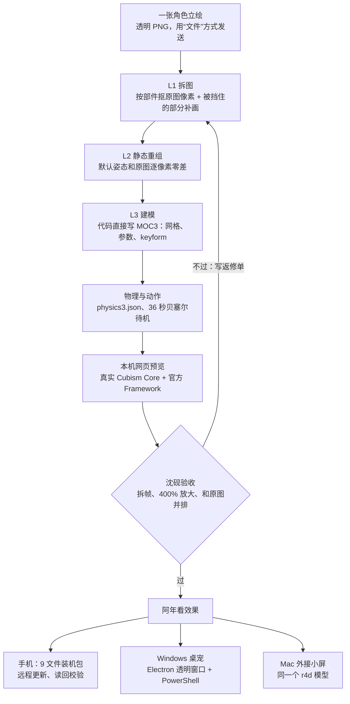

# 纯 AI 做 Live2D：从一张图到手机和桌宠

> 本文根据本仓库和两个相关项目的真实记录整理（2026-10-21 至 2026-11-04），不是理想化教程。做对的、做错的、返工的都写在里面。
> 文中的 `work/…`、`docs/plans/…`、`ASTRA_HANDOFF.md`、android-body、desk-companion 等路径指原始私有项目，里面含原画和模型，没有公开；这里只公开方法。
> 文中所有数字都来自记录文件，出处写在括号里。记录没写清的地方会标注“（记录里没写清：…）”。
> 人物：**阿年**（提供原画、拍板、真机试用），**沈砚**（Claude Opus 5.5，写施工单、验收、装机上线），**Astra**（模型 GPT 6 Astra，跑在 Codex 桌面版里，负责主要施工；下文简称 Astra）。

---

## 0. 先看全貌

### 0.1 总流程



### 0.2 实际走过的版本线

| 日期 | 版本 | 发生了什么 | 出处 |
|---|---|---|---|
| 10-21 | V1 | 黑底 JPG 硬拆 25 层，12 参数，没有物理，能动 | `docs/LIVE2D-PLAYBOOK.md` 第三节 |
| 10-25 | V1 上手机 | 手机黑屏（动作还没加载就开始绘制），修好 | android-body `HANDOFF.md` 10-25 22:34 |
| 10-26~27 | V2 r3 | 加嘴形、眉毛、高光、6 区头发 + 官方 physics、双耳分开摸；阿年确认 | `docs/V2-CHANGES.md` |
| 10-29 | V2 进手机 | 真机上难看：“眼睛裂开、耳朵也是”；查出根因：原图被 Telegram 压成了黑底 JPG | `docs/plans/2026-10-29-v4-rework.md` |
| 10-29 22:30 | V5 重做 | 决定照博主办法分窗口重做（L1→L5→装手机） | `docs/plans/2026-10-29-v5-redo-by-blogger.md` |
| 10-30 | L1 r03–r08-r2 | 先“全部 AI 重画”失败，改回“原图优先 + 补画”，r08-r2 14:25 验收通过 | `work/v5/L1/*/REVIEW-*.md` |
| 10-30 | r1→r3 | 建模、装机包，动态毛病两轮修，17:5x 装上手机 | `work/v5/delivery*`、android-body `HANDOFF.md` |
| 10-30 | r4→r4d | 闭眼、戳脸反应、待机幅度；22:4x 装上手机 | `work/v5/BRIEF-*.md`、`PROJECT_STATUS.md` |
| 10-31 | 小屏 | 同一个 r4d 放到 Mac 外接 Wokyis 1280×720 小屏 | `dock-display/README.md` |
| 11-04 | 桌宠 v5 | Windows 透明桌宠 + 按住侧键说话，23:16 真机全链路跑通 | desk-companion `PLAN-v5.md`、`HANDOFF.md` |

从决定重做（10-29 22:30）到新模型装上手机（10-30 17:5x），大约用了 19 个小时。到闭眼和戳脸都调好（r4d，22:4x）又过了约 5 个小时。

### 0.3 分工（记录里实际是这样）

| 角色 | 做什么 | 不做什么 |
|---|---|---|
| 阿年 | 提供原画；看图拍板（“是不是他”“像不像”）；真机试用；把开工话贴给 Astra 新窗口；中途直接纠正方向（比如 10-30 07:34 改成“原图优先”） | 不写代码 |
| Astra（GPT 6 Astra，Codex 桌面版） | 拆图、补画、写构建脚本、写 MOC3、做物理和动作、录视频、跑测试、打装机包；手机接入（“H 窗口”）；桌宠 v5 的调研和第 2–6 步 | 不自己往手机送包；不连 VPS；做不通就停下写原因，不能自己换方案 |
| 沈砚（Claude Opus 5.5） | 写施工单和返修单；验收（拆帧、400% 放大、和原图逐条对照）；装机（远程更新、读回）；桌宠上线（VPS 部署、隧道、真实接口、Windows 现场排错） | 10-30 阿年定的规矩：Live2D 只验收、提意见，不自己动手画（省额度）（沈砚的工作笔记） |

需要更正的一点：**V1 的施工单不是沈砚写的**。`ASTRA_HANDOFF.md` 开头写的是“阿年明确指定由 Astra 实际制作；另一个 AI 助手负责保持范围、检查证据和最终交付”。V2 细调单是沈砚 10-26 写的；V2 后半程是阿年直接带着 Astra 改的（`HOW-IT-WAS-MADE.md` 第 5 条）。V5 起才完全变成上表的分工。

### 0.4 成本和时间

- Astra 跑在 Codex 桌面版上，用的是阿年的 ChatGPT 额度（沈砚的工作笔记）。10-30 起因为额度紧张，除 Live2D 外其他项目全部暂停（android-body `HANDOFF.md` “冻结 · 2026-10-30 07:35”）。
- 没有买任何软件或服务：没用 Cubism Editor，没装 VTube Studio，没请绑模师（`docs/plans/2026-10-26-...-v2-tuning.md` 列为“待阿年决定”，后来没走）。
- 桌宠用到的云接口（OpenRouter 转写/识图、MiniMax 语音合成）是现成账号。（记录里没写清：这一项目具体花了多少钱。）
- 返工本身就是最大的成本：L1 一天交了 r03、r04、r05、r06、r07、r08、r08-r2 七版。下面每一节的“踩过的坑”基本都是返工的原因。

### 0.5 需要准备什么

1. **原画**：一张透明底 PNG，越大越好。我们的是 RGBA 1086×1448（`input/PROVENANCE.md`）。**必须用“文件”方式发送**，见第 1 节。
2. **一台 Mac 或 PC 跑施工**：Python 3 虚拟环境，依赖锁在 `requirements.lock`（attrs 26.1.0、numpy 2.5.4、opencv-python-headless 5.0.0.93、pillow 13.0.0、psd-tools 1.25.0）；Node + Playwright（录屏和浏览器检查用）；ffmpeg。
3. **Live2D 官方运行库**：Cubism Core（专有，自己从官网下载，本项目验证的版本是 5.1.0）；Cubism Web Framework 5-r.2（提交 `e3c4ba18…`），用 esbuild 0.28.2 打成单文件（`work/vendor/FRAMEWORK_VERSION.json`）。
4. **博主的 skill**：`fifteen42/live2d-from-art`（本机快照在 `~/.codex/skills/live2d-from-art/`，含 SKILL.md 和 5 份 references）。它不是一键生成器，是“一次案例的流程 + 代码”，每个角色都要重新改坐标、蒙版、网格和参数（`docs/LIVE2D-PLAYBOOK.md` 第二节）。
5. **一个能干重活的 agent**（我们用的是 Astra）和**一个专门验收的 agent**（沈砚）。建议这两个角色分开，原因见第 8 节。
6. 目标设备：我们是小米翻盖手机（外屏有 L 形可用区，网页 PWA）和阿年的 Windows 游戏电脑。

---

## 1. 第 0 步：拿到真正的原图

**目标**：拿到不压缩、带透明通道的原图，记录 SHA-256，之后任何步骤都不许改它。

**用什么**：`ffprobe` 或 Pillow 查格式；`shasum -a 256`。

**怎么做**
1. 让画师或作者用 Telegram / 微信的**“文件”**方式发送（Telegram 里是点回形针→文件），不要选“照片”。
2. 收到后先查：格式是不是 PNG、有没有 alpha（`pix_fmt` 应该是 rgba）、尺寸多大。
3. 放进 `input/`，把 SHA-256 写进 `input/PROVENANCE.md`。测试里加一条“input 不可变”。

**要抠的细节**
- 拿到图的人负责第一眼查格式，不能等做到一半才发现。
- 宽或高低于约 1000px 的图，拆出来的虹膜只有十几二十个像素宽，眼波细节会受限（V2 时虹膜只有约 26×15px，高光只有 2–4 个原始像素，`docs/V2-CHANGES.md` “质量边界”）。

**踩过的坑**
- **10-21 到 10-29，前后做了 V1、V2 两版，用的都是一张被压坏的图。** 阿年当时发的是透明 PNG，Telegram 按“照片”自动压成了 960×1280 黑底 JPG（yuvj420p）。黑底去不干净，边缘一圈黑灰毛边；黑色眼线和头顶发圈被误当成背景去掉；细发丝只能做到约 1px 收边，找不回原来的 alpha（`LIVE2D-PLAYBOOK` 三-3、`v4-rework` 一-1/2）。10-29 22:20 阿年用“文件”重发，才拿到真正的 RGBA 1086×1448（`PROVENANCE.md`）。沈砚的工作笔记里专门记了这条：收到素材图先查格式（沈砚的工作笔记）。

**怎么验收**：`PROVENANCE.md` 里有 SHA；图像模式是 RGBA；四角确实透明，不是黑色或白色。

---

## 2. 先把参考资料写成文档，只看一次

**目标**：把参考（博主视频、教程）一次性拆解成文字，以后所有施工单都引用这份文档，不再回头去看视频。

**用什么**：视频抽帧 + 转录；本项目的产物是 `docs/LIVE2D-PLAYBOOK.md`。

**怎么做**
1. 把参考视频逐步拆成表格：每一步做了什么、画面里能看到哪些细节（我们的是小红书“当我用Astra做Live2D皮套…”，83 秒，见 PLAYBOOK 第一节）。
2. 写清工具链的限制（PLAYBOOK 第二节）、自己做过的版本踩过哪些坑（第三节）、“模型问题还是渲染问题”的排查表（第四节）、参数命名规范（第五节）、验收清单（第八节）。
3. 以后写单子时，逐句引用这份文档。

**要抠的细节**
- 博主的关键做法是：**先让 AI 生成一张“为拆件而画”的原图**，透明底、超大，拆成 42 层（头发约 15 片，虹膜单独一层）。而我们是拿一张现成立绘硬拆（V1 只有 25 层、头发 4 片）。这是上限差别的根源（PLAYBOOK 第一节末尾）。
- 博主自己也承认第一版“有点恐怖”：眼睛被压扁、眉眼不协调（PLAYBOOK 第一节第 5 行）。不要指望第一版就好看。

**踩过的坑**
- 10-29 沈砚没核对文档就凭印象说“博主是画师一层层画的”“我再去看一遍视频”，两句都错。阿年要求以后只读文档、开口前先核对（沈砚的工作笔记；`v4-rework` 开头记了阿年原话“从来没有画师，都是博主叫 AI 做的”）。

---

## 3. L1 拆图：最要紧的一步

**目标**：把原图拆成能各自动的部件（PNG + 坐标 + 遮挡蒙版 + PSD），**默认姿态拼回去和原图逐像素一致**，被挡住、动起来才会露出的地方补画完整。

**用什么**
- Python：Pillow、NumPy、OpenCV、psd-tools（脚本：`work/v5/L1/r05/build_layers.py`，r08-r2 的 `repair_layers.py`、`make_evidence.py`、`check_r2.py`）。
- 补画：Codex 环境内置的 ImageGen（V1 的三张补画提示词见 `docs/IMAGEGEN.md`；V5 的隐藏件提示词和 SHA 在 `L1/r04/selected-provenance.json`）。
- 博主 skill 的 `references/artwork.md`。

**怎么做（最终走通的 r05 → r08-r2 路线）**
1. **可见部分直接用原图像素**，按部件分配。皮肤和细线混在一起的半透明边缘，用“反求 alpha / 前景色”拆开，避免移动部件带着一块肤色（`r05/README.md`）。
2. **被挡住的部分才补画**：耳根（要画长，伸进头发下面）、耳后头皮 / 后发底、口腔（深色 + 上牙 + 舌）、刘海下的额头、闭眼皮、头发后面的衣服。补画只用在“动起来才露出”的位置，**绝不能用生成图替换看得见的脸**，否则会变脸（PLAYBOOK 第二节）。
3. 画布用原图的 2 倍整数倍（2172×2896）。这只是为了坐标方便，不代表多了细节（`r05/README.md`）。
4. 分层清单至少包括：脸底、脸部光影（单独一层）、脖子、左右耳、眼白、虹膜、高光、上下睫毛、闭眼线、眉、口腔 / 牙 / 舌、上下唇、多片头发、镜框、衣服各片。r05 是 57 层，r08 是 65 层（`ASTRA_HANDOFF.md` V5 各段）。
5. 每一轮都输出：深底、浅底各一张原图和拼合图的并排对照；眼睛和嘴的 400% 放大对照；六种状态（默认、眼珠左右、张嘴、闭眼、闭眼张嘴）的模拟图。

**要抠的细节（每一条都是返修单里出现过的）**
- **脸部光影层不能烘进别的部件的影子。** r05 的 FaceLighting 里烘进了镜框和刘海的形状，镜框一动，脸上就会留下一副“幽灵眼镜”（`r05/REVIEW` 第 1 条）。
- **半透明边缘要干净。** 反求 alpha 留下的灰白闪点，在灰底上看像撒了一层亮粉（r05 第 2 条）。
- **眼白必须完整连续**，不能留睫毛 / 高光抠走后的洞，否则眼珠一转就露出来（r05 第 3 条）。
- **虹膜是完整的一块**：瞳孔是圆的，被上眼睑盖住的部分也要补全（r05 第 4 条）。
- **闭眼补丁压在刘海下面**，形状沿眼眶走，不许有直角硬边，发丝要完整盖在补丁上（r06 第 1 条）。
- **闭眼线要用原图上睫毛的像素往下弯**，保留原来的粗细变化、深褐黑颜色和收尖。生成的细弧线“不像一个人画的”（r05 第 7 条、r07 第 2 条）。
- **牙齿**：画成一条柔和的白色弧带，只用极淡的竖线暗示 4–6 颗，不能是锯齿尖牙（r06 第 5 条、r07 第 3 条）。
- **2 倍放大要平滑重采样**，最近邻放大会在下颌、衬衫、耳边出现像素台阶（r06 第 4 条）。
- 左右眼本来就不对称，按各自的数据做，不许做成镜像（v5 单 L1“先量后画”）。

**踩过的坑**
- **10-30 00:00 的硬规定：“只许让图像生成重画每个部件，禁止抠原图像素。”** 这是为了模仿博主而定的（`v5-redo-by-blogger.md` 第二节 L1）。r04 照做，交了 56 层，结果失败：整体横截面宽度在 y=50 处多了 9.92%，y=500 处多了 14.99%；右眼开口偏窄；“画风和神态仍不像原图”；还出现过整脸误生成、方形瞳孔（`L1/r04/STATUS.md`）。Astra 按单子“做不到就停下写原因”，交了失败证据，没有自己换路线。这一点做得对。
  **原因**：逐件独立生成，无法同时锁住轮廓、笔触、光照和神态（r04 STATUS“当前路径没能达标的原因”）。**结论**：如果你手里已经有一张定稿立绘，别让 AI 把每个部件重画一遍，会变脸。
- **10-30 07:34 阿年直接纠正：优先抠图，取不到的嘴内、耳根才补画，拼回要和原图一致**（`r05/README.md`）。r05 默认态和原图一致，但单层问题很多（上面“要抠的细节”前五条）。
- **r06、r07 越改越坏**：为了修隐藏件，动了看得见的像素。眼白变多、眼睛像翻白眼、脖子出现缝合线一样的裂缝、头发外轮廓飘出碎片（`r07/REVIEW` 追加 4–8 条）。阿年说“丑得想吐”（沈砚的工作笔记）。
  **修法**：作废 r06、r07，回到 r05 做底，并写死一条硬门槛：**默认态可见像素一律不许动；每次交付先跑默认态和原图的逐像素差，最大差必须是 0，否则不许交**（r07 REVIEW“改法写死”）。
- r08 默认态零差，嘴通过，眼睛不过：闭眼补丁顶到头发上、补丁平涂没有渐变、眼线末端像梳子、眼白是硬块、虹膜上沿被横着切平（`r08/REVIEW` A1–A5、B1–B4）。r08-r2 全部修完，14:25 通过；另有两处小打磨不挡进度（`r08-r2/REVIEW`）。
- 沈砚的工作笔记里还有一条相关但有出入的说法：“10-29 L1 我漏写了‘AI 重画’，L1 走了抠像素路线，两轮不合格”（沈砚的工作笔记）。记录里 r01、r02 已被禁用（`ASTRA_HANDOFF` r04 段），（记录里没写清：r01/r02 具体用了什么方法、为什么不合格）。

**怎么验收**
- 默认拼合和原图：原生尺寸和 2 倍尺寸的 RGBA 最大差都是 0，差异像素为 0（r08-r2 达到了）。
- 每个状态的改动只出现在应有区域内（闭眼只动眼睛，张嘴只动嘴）。
- **单层铺灰底放大看**，不能只看拼合图。拼合图零差“不算本事”，动起来露出的才是问题（r05 REVIEW 第一句）。
- 最后由人看“是不是他”。

---

## 4. L2/L3 建模：用代码直接写 MOC3

**目标**：在不用 Cubism Editor 的前提下，产出 Core 能加载的 `.moc3`、`model3.json`、纹理、`physics3.json`、`idle.motion3.json`、`cdi3.json`、`parameters.json`。

**用什么**
- 本项目的 `src/build_model.py`（复用博主 skill 随附的 MIT 许可序列化器 `vendor/py-moc3`）；V5 的 `work/v5/L2/build_r08.py`（约 280 行，调用 build_model 的写入器、待机和物理函数）。
- Node 版 Core 检查：`work/v5/L2/check_rig.cjs`（加载真实 Core 5.1，检查每个参数确实带动了网格、双耳独立、36 组姿态组合数值有限）。
- `check_binding.py`：半眨眼时眼线和眼皮的间隙 ≤0.5 原生像素等检查。

**怎么做**
1. **先静态 MOC3**：默认姿态加载成功、和原图一致，再逐个加参数（眼 → 嘴 → 眉 → 头 → 身体 → 头发 → 耳朵）。每加一组留一个能回退的版本（skill SKILL.md“工作顺序”第 3 条）。
2. **参数用 Live2D 标准名**，VTS 等软件才能自动映射：`ParamAngleX/Y/Z`、`ParamEyeLOpen/ROpen`、`ParamEyeLSmile/RSmile`、`ParamEyeBallX/Y`、`ParamBrowLY/RY`、`ParamMouthOpenY`、`ParamMouthForm`、`ParamBreath`。自定义参数：耳朵 `ParamEarL/R`（物理输出）、摸耳输入 `ParamEarTouchL/R`、头发 `ParamHairFrontL/C/R`、`ParamHairSideL/R`、`ParamHairBack`。L/R 一律指**角色自己的**左右，和画面方向相反（PLAYBOOK 第五节、`V2-INTEGRATION.md` 参数表）。最终是 24 个参数。
3. **网格沿部件形状布点**，不要整张图切成同样的矩形格。嘴沿真实的唇线布点（`V2-CHANGES` 嘴形一行）。
4. **keyform 不要乱绑。** 轴越多组合越多，别把每个参数绑到每片网格（PLAYBOOK 第二节）。V5 的 MOC 有 104–105 个网格、约 1.9 万到 2.5 万个顶点，MOC 文件约 43–48MB（`ASTRA_HANDOFF` r08-r2 段、`PROJECT_STATUS` r4d 段）。
5. **头部转动要有视差**：上半脸跟得多，下颌附近减弱；脖子上端轻微跟随，锁骨和衣领固定（`V2-INTEGRATION` “颈部与画质”）。

**要抠的细节**
- **眨眼不能压扁虹膜**：用眼眶蒙版盖住，而不是把虹膜纵向缩放（博主第一版就栽在这里，PLAYBOOK 第一节第 5 行）。
- **眼睛的三层拆分**：r08-r2 把原眼睛拆成互补的 alpha 份额（外层 + OpenEyeInside），中性时能拼回原样；眼珠一动，内层就淡出，避免旧虹膜残影。**不要退回“开口>0 就裁掉”的二值做法**，那样会出锯齿白缝（`work/v5/CONTINUE-r08.md` L2 段）。
- **眼眶蒙版要有自己的坐标和完整范围**，不能按虹膜 PNG 的大小裁，也不能跟着虹膜移动（`ASTRA_HANDOFF` r07 段末尾）。
- **SourceOpacity 技巧**：为了让 GPU 渲染的默认态 alpha 和原图完全一致，r08-r2 加了一个隐藏的辅助网格，只存原图的覆盖 alpha（RGB 白色，不存原图颜色）。渲染时**最后一步**用 `gl.blendFuncSeparate(ZERO, SRC_ALPHA, ZERO, SRC_ALPHA)` 乘上去。标准 SDK 里它的不透明度是 0，所以普通渲染器看不到它；但必须用随包的 `live2d-v2.js`，只换 MOC 不换渲染器就验不出零差（`work/v5/DELIVERY-README.md`“使用与边界”）。
- **说实话**：GPU 默认输出的不透明区域 RGB 差 0、alpha 差 0，但半透明像素的储存颜色受预乘量化影响，不能说成“整个 GPU 输出 RGBA 零差”（同上）。
- 原图坐标 1086×1448，手机坐标沿用 960×1280，缩放系数 `960/1086` 写在 `build_r08.py` 开头。

**踩过的坑**
- **加载成功但画面空白**：渲染器没处理 Core 的 Y 轴 / UV 翻转（V1，PLAYBOOK 三-1）。
- **测试绑定了旧模型的哈希**，结果用旧证据通过了新模型。测试要拒绝和当前文件对不上的证据（PLAYBOOK 三-4）。
- **耳尖贴着画布边**，大角度转头时被裁掉（PLAYBOOK 三-5）。画布四周要留余量。
- **没有 `.cmo3`**：这条路线不经过官方编辑器，以后不能用 Cubism Editor 打开修改（PLAYBOOK 第二节、`LICENSES.md`）。如果需要长期编辑，要另外请绑模师。

**怎么验收**
- Core 能加载；每个参数推到最大和最小都有可见变化。
- 组合检查：转头 + 张嘴 + 眨眼同时做，不穿层（r08-r2 跑了 36 组；r3 跑了 94 组；r4 起跑 121 组）。
- 默认渲染和静态模型逐像素一致。

---

## 5. 物理、待机和口型：让它“活”

**目标**：头发和耳朵有惯性、能回弹；待机像人在发呆而不是钟摆；说话时嘴跟着声音动。

**用什么**：官方 Cubism Web Framework 5-r.2 的 `CubismModel`、`CubismMotion` + `CubismMotionQueueManager`、`CubismPhysics`。

**怎么做**
1. **physics3.json**：V2 起共 8 组：6 组头发由 AngleX（65% 位移）和 AngleZ（35% 角度）驱动；2 组耳朵**各自只读** `ParamEarTouchL/R`（`V2-INTEGRATION` “物理与触摸外力”）。发根固定，发梢幅度最大，各组延迟略有不同。
2. **待机**：36 秒循环、受限贝塞尔曲线、3.5 秒过渡加停留；眨眼间隔不等；呼吸轻微；视线偶尔小变化。**待机曲线里不要写头发和耳朵**，这些交给物理。在第 12 秒、第 27 秒分别给左右耳一个很小的输入脉冲（同上“视线、眨眼、待机”）。
3. **每帧顺序只有一种**：恢复基础参数 → 待机动作 → 外部头部 / 视线 / 眨眼 → 音量和表情 → `physics.evaluate(model, dt)` → Core `update()` → 绘制。`dt` 上限 0.1 秒；切回前台时重新稳定物理（同上“必须接上的运行能力”）。
4. **摸耳**：给对应输入一次平滑脉冲，0.5 秒升到峰值，1.3 秒回到 0；耳朵约 0.45 秒展开，2–3 秒回稳。不要直接写物理输出 `ParamEarL/R`，也不要用全局风力模拟单只耳朵（同上，附代码）。
5. **音量口型**（不是音素识别）：从**实际正在播放的音频**取 RMS。起调值：阈值 0.012、增益 4.5、上限 0.85、张嘴 35ms、闭嘴 75ms；`ParamMouthForm` 跟 0.4×，双眼微笑跟 0.08×。音频结束、取消、失败、页面隐藏时全部归零（同上“音量口型”，附代码）。

**要抠的细节**
- **只有 Core、没有 Framework，物理不会生效**，贝塞尔动作也不会播放。V1 的手机端就是这种情况：自写 WebGL 只跑 Core，头发和耳朵的晃动其实是写死的线性关键帧（PLAYBOOK 第二、四节）。
- Framework 5-r.2 里必须调用 `motion.setEffectIds(...)`，传入 model3 里 EyeBlink / LipSync 分组的 ID，否则播放时会报错（`V2-INTEGRATION` 初始化顺序第 2 条）。
- 物理输出不能再当作下一帧的外部输入，否则会自激振荡（同上）。
- 耳朵触摸区要按原画坐标换算：角色左耳在画面 x=535–675、y=0–210；右耳 x=270–410、y=0–210（960×1280 坐标，同上）。
- **戳脸反应**（r4）：头往被戳的方向歪约 10°（AngleX/Y 合计），AngleZ 约 3°，像弹簧一样 1 秒内回正；头发靠物理甩起来，双耳轻抖，眨一次眼。连续狂戳时合并冲击、设上限，最小间隔约 250ms，幅度不能越叠越大（`BRIEF-沈砚-r4` 第 2 节）。
- **待机幅度**（r4）：头部晃动加到原来的约 2 倍，呼吸 0.9，每隔 8–20 秒随机往旁边瞟一眼。不能额外开 RAF、定时器或服务（同上第 3 节）。

**踩过的坑**
- **V2 首交，阿年说“几乎看不出区别”**。原因有两个：录屏只截了待机最开始的 4 秒，刚好在停留段；幅度缩得太小。修法：放大真实幅度，录像里专门安排能看出变化的段落（`V2-CHANGES` “视觉反馈后的修正”）。
- **嘴“像割开一条缝”**：整条闭嘴线都归给了上唇，下唇单独往下拉，口腔用直线缩放。修法：按原图的接触曲线拆开上下唇，嘴角共用，口腔两边分别贴住两条唇缘（`V2-CHANGES` “嘴部形态纠正”）。
- **摸一只耳朵，头发也跟着动**：原来的“轻戳”是给所有物理组同一阵风。修法：每只耳朵一个独立输入，只驱动自己那组（`V2-CHANGES` 双耳一节）。
- **转头像扯着脖子**：旧变形把脸和脖子一起横移，上颈测试点在组合极值时移动约 31px。修法：脖子上端少量跟随，下端和衣领固定，下颌附近减小视差（同上）。
- 口型至今没有完全满意：r4d 装机后阿年说嘴“动了但粗糙”，以后单独开单抠口型（android-body `HANDOFF.md` r4d 段、待办记录）。

**怎么验收**：按 PLAYBOOK 第八节逐条看。转头后发梢慢半拍，几束有先后；单耳只抖单耳；待机 30 秒不晕、不像纸片；说完 0.3 秒内闭嘴。

---

## 6. 本机预览和录像：给人看的证据要可信

**目标**：用真实 Core 渲染，和原图并排、同一尺度，能调每个参数，能复位；录出能对照的视频。

**用什么**：`python3 -m http.server`（只绑 127.0.0.1）；`work/v5/L2/preview.html`（滑块 24 个、复位、眨眼、待机、深浅底切换）；Playwright 驱动 Chromium（`capture.cjs`、`L3/record-preview.cjs`）；ffmpeg。

**要抠的细节**
- **按手机实际大小看**：600×1000 视口的整个人物，再看 400% 放大，两者都要和原图睁眼状态并排（`BRIEF-沈砚-r4` 第 1 节）。只看放大图会把问题看歪：4 倍图只是把原图放大，不能据此证明“原图不够清楚，必须换稿”（`CONTINUE-r08-current.md` “最新反馈：清晰度”）。
- **画质**：开 MSAA，按 2 倍空间采样后只缩小一次；纹理按 1:1 放进图集，不缩小。录像从 PNG 帧直接一次编码成 H.264（CRF 14），另外附一张无损静帧（`V2-CHANGES` 画质一条）。
- 本机录像的帧率（如 r08-r2 的 27.52fps）**不代表手机性能**，每份交付都要写清这一点。

**踩过的坑**
- 录像发糊、边缘锯齿：预览原来关了 MSAA，录像还经过 WebM→MP4 两次编码（`V2-CHANGES` 画质一条）。
- r4c 期间为了“更清楚”试过全局改用 LINEAR 过滤，结果更平滑但出现了层间接缝，没有采用（`CONTINUE-r08-current.md`）。

---

## 7. 动态验收：静态零差不等于动起来没问题

这是整个项目里最有价值的一套方法，单独写一节。

**沈砚的做法**（`delivery/REVIEW-沈砚-装机前-20261030.md`）：
1. 把 40 秒预览视频拆成每秒一帧（第二轮改成每秒两帧），从头看到尾。
2. 挑出说话帧、转头帧，放大 4 倍，和 `reference.png` 并排对照。
3. 发现问题就给出坐标（原生坐标和 2 倍坐标都写），说明怀疑是哪一层，并写明**不许怎么修**（比如“不许靠盖头发去遮”）。
4. 要求 Astra 重录视频，并单独截这几帧：待机、说话、左转到底、右转到底、闭眼、闭眼说话；每帧都要全身图，加左眉、脖子、下颌三处的 400% 放大。

**真实抓到的三个动态毛病**（r1，10-30 15:40）：
- 左眉左上方的头发里有一道浅灰色水平细线，几乎每帧都有。
- 转头时脖子左侧的蓝色领口上出现一条橙棕色竖线：脖子轮廓线跟着头动，滑到了领口上面。
- 转头时头发边缘有零星白点和黑点。

r2 修好了后两条，灰线在待机和转头时没了，但**说话那段（20.0–27.5 秒）每一帧都还在**（`L2/preinstall-repair/REVIEW-沈砚-补充-1710.md`）。
**原因**：手机的 `live2d-v2.js` 说话时会把 `ParamEyeLSmile/RSmile` 设成 0.08×、`ParamMouthForm` 设成 0.4×。画面左侧的 `BrowR` 网格里含有原图头发，`ParamEyeRSmile` 会把整片挪开，露出下面浅色的接缝。r2 的静态“说话”检查漏了眼睛微笑这个输入。
**修法**：只解除这一个网格的附带联动（r3），用 94 组 Core 对比确认只有它变了（`ASTRA_HANDOFF` r3 段）。
**教训**：检查时要用**运行端真实会同时写入的参数组合**，不能只推单个参数。

**闭眼连改四版的经过**（r4→r4d，都是 10-30 晚上）：
- r4：闭眼线改细到约 1.12 像素。数字全对，但手机大小下看“整张脸像没有眼睛”（`BRIEF-r4b` 第 1 条）。教训：单子写“跟原图下眼线一样粗”，不是越细越好。
- r4b：中段 2.8 像素，两头收尖，外眼角带拖尾，沿原下眼缘走微弧；补丁只盖眼睛开口，不往外扩。
- r4c：补丁里取进了前面几缕头发的颜色，羽化后变成竖条纹；右眼外沿发红；半眨眼边缘是白色锯齿（`BRIEF-r4c`）。参考《代号鸢》动态 CG 的闭眼加了浅褶和阴影，但脸和眼形用自己的（`CONTINUE-r4c.md`）。
- r4d：收窄柔化范围（面积减少约 42%），黑边单独抗锯齿（`PROJECT_STATUS` r4d 段）。阿年真机看：“这次真的好看了”（待办记录）。

**一句话标准**（`BRIEF-r4b`）：手机大小下一眼看上去是“这个人闭着眼睛”，而不是“眼睛被涂掉了”。先用这个标准自己看，过不了不许交。

**测试的诚实度**：19 个旧测试里有 2 个（镜框中心线、字幕过期）在没改过的原工程里本来就失败。每一版都单独列出，**没有放宽断言**，也不写成“全部通过”（`DELIVERY-README.md`）。r4d 初版有一次降温断言异常没能复现，原记录保留，没有声称修好了未知原因（`CONTINUE-r08-current.md`）。

---

## 8. 怎么给 agent 写施工单

### 8.1 第一条必须是“做法写死”

这是 10-29 吃过亏后定的规矩（沈砚的工作笔记）：
- 第一节写**方法**，不只写结果：只许做什么、禁止什么、哪些已作废、换方法先问。
- 措辞要防止被字面误读。比如“不许变”，要写清是“验收像不像”，还是“不许动这些像素”。
- 写完逐句对照参考原文核对一遍。
- **不要写“做完一组停下等我验收”**，要求一口气做完；验收意见可以中途插进去，Astra 改完接着做（阿年 10-30 01:09 定）。
- 但调研类任务例外，**要求停下等选路**（桌宠 v5 第 1 步就是“调研完停下等沈砚”，`PLAN-v5.md` 第〇节）。

### 8.2 骨架（从 `BRIEF-沈砚-r4-20261030.md` 和 `desk-companion/PLAN-v5.md` 提炼）

```markdown
# <项目> 开工单 <版本> · <日期时间>

## 〇、做法写死（先读这一节，违反任何一条 = 不验收）
- 基线：以 <冻结目录/版本号> 为底；旧版本 r1/r2/... 一律不许覆盖。
- 只许改：<文件 / 图层 / 参数，逐个列出>
- 禁止：<AI 生图 / 改默认态可见像素 / 动已通过的部件 / 碰手机、VPS、钥匙 / 自己往设备送>
- 作废：<已经否掉的做法>
- 换做法先问；中途不许停下等确认（调研类任务除外：写完结论停下）。
- 先读：<文档清单，精确到路径和章节>

## 一、要做什么（逐条，每条写清“现状 → 要改成什么 → 为什么”）
1. ……（引用阿年原话或真机反馈）

## 二、交付自查（自己先查，过不了不许交）
- 硬数字：默认态和原图 native/2x RGBA 最大差 0；GPU 不透明区 RGB 最大差 0（附数字）
- 画面：手机实际大小整张 + 400% 局部，都要和原图并排；列出必须截的帧
- 视频：40 秒，包含 <待机/眨眼/戳左脸/戳右脸/狂戳 3 秒/摸两只耳朵/说话>
- 测试：现有测试照跑；原本就失败的单列，不许放宽断言
- 版本号 <v8-...-rN>，输出到新目录 <delivery-rN/>，回滚基线 <rM>
- README 逐条对应第一节的每一条，写清改了什么、证据在哪

## 三、不做 / 留给谁
- 装机、上线、真机测试由沈砚做；Astra 不做
```

### 8.3 交接规矩（`v5-redo-by-blogger.md` 第一节）
- 下一步只能用上一步冻结在 `work/v5/Lx/` 里的文件，并附 SHA 清单。
- 上一步没通过验收，下一步不许开工。
- 哪一步出了问题就退回哪个窗口改，**下游不许顺手改上游**（比如建模时发现耳根没画够，要退回 L1 补画，不许拉伸网格去掩盖）。
- 每个窗口只写自己的目录和 HANDOFF 里自己的段落。
- Astra 的上下文会满，所以要写断点文件（`work/v5/CONTINUE-*.md`），新窗口从断点接着做。

### 8.4 开工话
施工单写在文件里，开工话只有一两句，由阿年贴给新的 Astra 窗口。例子（`PLAN-v5.md`、沈砚的工作笔记）：
> 读 PLAN-v5.md，先做第 1 步调研，写进 HANDOFF.md 的《v5 调研》，写完停下等沈砚，不要开始第 2 步。

---

## 9. 怎么验收（给验收方的规矩）

1. **先做逐条对照表**：参考里的每一条和交付里的每一条对上，没对完不说“好了”，只说“还差哪几条”（沈砚的工作笔记）。
2. **自己核，不信对方报的数字**：r08 的验收单第一节标题就是“我自己核过的（不是看你的数字）”，比如自己用 `reference.png` 最近邻放大 2 倍去和拼合图做差。
3. **先看手机实际大小，再看 400% 放大**，并且永远和原图并排。
4. **动态要拆帧看**（第 7 节）。
5. **证据要绑定哈希**：报告里记录实际加载的 MOC、纹理、动作、物理的 SHA，和交付文件对得上（`README.md` “本机预览”、PLAYBOOK 三-4）。
6. **分清验到了哪一层**：能加载、能动、好看，是三个不同的层级，分别报告（skill SKILL.md 开头）。本机浏览器通过不等于手机通过，网页通过也不等于 VTS 通过。
7. **没全测不说“好了”**：列出已验和未验；模拟不了的明确告诉对方“这一项还没验”（沈砚的工作笔记）。
8. 交付时**不冒称**：Astra 的每份交接都写“共享交接不代表沈砚已读”“不冒称阿年已审美确认”。验收方也应该这样写。

---

## 10. 装进手机

**目标**：把模型换进手机的脸页（PWA），保留已有的手势、字幕、降温等功能。

**用什么**：android-body 项目的 `face/live2d-v2.js`（H 窗口 10-29 写的官方 Framework 接入）、`face/face.js`；B7 远程更新通道（`home/update_phone.py` 的 `upload` / `request('update')`）；Shizuku（手机端执行安装）。

**怎么做**
1. 接入（10-29，Astra 的 H 窗口）：把官方 Framework 打包成单文件 `face/vendor/cubism-framework.js`，不走外网 CDN；新建 `face/live2d-v2.js` 负责 CubismModel / Motion / Physics，按第 5 节的每帧顺序执行；保留眼白和高光的 stencil 裁切、透明混合；highp + MSAA，内部至少 2 倍采样再缩到页面大小（android-body `HANDOFF.md` “H Live2D V2 开工”）。
2. 之后每次换模型只送 **9 个文件**：`face/face.js`（只改模型缓存号）、`face/live2d-v2.js`，以及 `face/runtime/` 下的 MOC、model3、纹理、physics3、idle、cdi3、parameters（`ASTRA_HANDOFF` r08-r2 段）。
3. 装之前：先读回手机当前版本和这 9 个文件的哈希，确认基线；如果手机上有别人后来的改动，先合并再重新出包，不能覆盖。
4. 装：上传 → 请求更新 → 读回 `installed`、`current_version`、`page_ready` 三处是否是同一版本，再核对运行资源的哈希（`delivery-r4d/INSTALL.md`、android-body `HANDOFF.md` r4d 段）。
5. 回滚：整套 9 文件一起回退，不能只退 MOC（`V2-INTEGRATION` 回滚一节）。r4d 的回滚基线是 r3，r3 一直留在更新仓库里。

**要抠的细节**
- 外屏 L 形可用区要保持 960:1280 比例，头顶留出空间，字幕不能压脸，触摸坐标要随裁切一起换算（`PLAN-20261028-live2d-phone.md` 第四节）。
- 闲置 5 分钟回到小眼睛（防烧屏，这是界面层的功能，不是模型能做的）。
- 温度到 ≥42℃ 时 Live2D 也要换成闭眼并停止渲染。
- 装机包里不能混进测试、备份、日志、电话或识图代码。

**踩过的坑**
- 10-25 V1 手机黑屏：模型已经建好、待机动作还没加载完，动画就去访问空对象，RAF 停了。修法：两者都就绪才开始绘制（android-body `HANDOFF.md` 10-25 22:34）。
- 10-27 远程更新时 Shizuku 停了，首次送包自动回滚。送包前要确认脸页在前台、处于空闲，并且 Shizuku 在运行（`PLAN-20261028-live2d-phone.md` 第二节）。
- 10-30 r4d 首次发送报“keep the eyes page open and idle”，阿年重新打开页面后才通过（android-body `HANDOFF.md` r4d 段）。
- 口型数据源：脸页原本只知道“正在说话”，拿不到实际音频，所以 H 窗口一开始标了 BLOCKED，没有拿正弦假口型去凑数。后来电话从现有输出 gain 分支接 Analyser，日常播放则在脸页用 OfflineAudioContext 解码同一段 MP3，按 20ms 取 RMS，再用播放时钟驱动（android-body `HANDOFF.md` H 段第 990、1130 行附近）。
- **发热**：10-30 18:14 刚打开 Live2D，手机就到了 40.6℃（沈砚的工作笔记）。30 分钟温度和帧率对比至今没有完整实测数据（记录里没写清：最终数字）。

**怎么验收**：读回三处同版本 + 哈希一致；真机看闭眼、半眨眼、戳脸、摸耳、待机、说话；最后阿年看外屏实拍说好才算完。

---

## 11. 番外：Mac 外接小屏（10-31）

`dock-display/` 是一个 macOS 小程序（`沈砚小屏.app`，Swift），把同一个 r4d 模型显示在 Wokyis 1280×720 外接小屏上。万圣节版左侧加了南瓜灯、幽灵和会下垂的蜘蛛；右侧用透明文字显示手机最近 30 条聊天，通过 USB 读手机原有接口获取（`dock-display/README.md`、`PROJECT_STATUS.md` 开头）。模型文件通过符号链接复用，没有另做一份。这说明：**模型包一旦做成标准 runtime，换宿主只是写一层壳。**

---

## 12. Windows 透明桌宠（11-04）

**目标**：阿年玩游戏时，屏幕右下角站着 r4d 的沈砚：背景透明、置顶、不挡游戏点击；按住人物能拖动，位置会被记住；沈砚说话时字幕飘在头顶，声音从这里播放，嘴跟着动；按住鼠标侧键说话（`PLAN-v5.md` 第一节）。

### 12.1 架构

```text
[Windows]
  start.bat → PowerShell 5.1 desk-overlay.ps1   截图、侧键钩子、录音(WinMM)、鉴权、长轮询、托盘、热键
      │  私有命名管道 --desk-pipe=<随机名>（文字 + 音频字节）
      ▼
  Electron 45.2.2 (win/live2d/main.cjs)          透明无边框置顶窗口 420×620，只管显示、字幕、播放
      └─ 页面 app.js + r4d.js（从手机版 live2d-v2.js 移植）+ Core 5.1.0 + Framework 5-r.2

[VPS]  judge（鉴权/闸门/识图/转写/语音合成） → entry（注入沈砚会话） → 沈砚回话 → judge 合成 MP3 → Windows 取走播放
```

- 选 Electron 而不是“PowerShell + WPF + WebView2”，是因为 Astra 的调研发现 WebView2 透明宿主、WPF airspace、人物轮廓点击穿透三件事要在 Windows 上组合验证，没把握；Electron 有现成的透明窗口和 `setIgnoreMouseEvents(true,{forward:true})`。代价是包更大：ZIP 172,884,573 bytes，解压后 426,887,045 bytes，共 98 个文件；阿年不用装任何运行时（desk-companion `HANDOFF.md` 调研第 1 节、第 6 步）。
- **人物外穿透**：每次按光标处的人物 alpha 判断，只读一个像素（`gl.readPixels` 1×1，alpha>12 算命中），命中时接收鼠标，否则穿透。没有用实验性的 `setShape`，因为它会把头顶字幕也裁掉（`win/live2d/app.js` 的 `hit()`、调研“B 的边界”）。
- **Electron 安全设置**：sandbox、contextIsolation、禁 Node、拒绝所有权限请求、禁止导航和弹窗；页面拿不到设备口令（`main.cjs`）。
- **录音**：PowerShell `Add-Type` 内嵌 C#，P/Invoke `winmm.dll` 的 `waveIn*`；16kHz、单声道、PCM16 WAV；最长 30 秒，只发一次（30 秒的 WAV 是 960,044 bytes）。不装第三方包（调研第 2 节）。
- **转写**：在 VPS 的 judge 上，OpenRouter `google/gemini-2.5-flash-lite` 为主、`google/gemini-2.5-flash` 兜底，每次最多 8 秒，总期限 20 秒（从松开按键算起）；空文本、纯数字、纯时间戳当噪音丢掉。语音单独限制每小时 60 次，不占沈砚主动开口的额度（`PLAN-v5.md` 第七节）。
- **嘴型**：原样继承 r4d 的参数和包络（阈值 0.012、增益 4.5、上限 0.85、35/75ms），不重新设计（调研第 4 节）。
- **模型文件**：从 r4d 交付只读复制 7 个运行文件，逐个核对 SHA（MOC `e4923a66…`），模型、纹理、物理一律不改（第 2 步表格）。

### 12.2 怎么做（按施工单顺序）

1. 沈砚写 `PLAN-v5.md`，第〇节写死做法：只许在 desk-companion 里写；在 v4/v4b 基础上加，不许推倒重来；只用 mock；不碰钥匙和 VPS；不改模型；**第 1 步只调研，写完停下**。
2. Astra 交调研（两种窗口壳逐项对比，附官方文档链接、体积、阿年需要做几步）→ 沈砚选路（PLAN 第七节）。
3. Astra 做第 2–6 步：页面 → Electron 壳 → 按住说话 → judge/entry → 打包。64 项测试通过；Mac 上三进程内存 82.805 MB，超过 60 MB 的门槛，**原样报失败，没有放宽阈值**。沈砚选择上线时在 VPS 上实测（PLAN 第八节）；实际启动约 68 MB，在 60–100 MB 区间内接受（沈砚的工作笔记）。
4. 沈砚上线：部署 VPS 服务、开隧道、接入口、开真实转写；然后和阿年一起在 Windows 上现场调试。

### 12.3 Windows 现场踩过的坑（11-04 晚，都已核实）

| # | 现象 | 原因 | 怎么解决 |
|---|---|---|---|
| 1 | 安装包下载不完整，只留下 `.zip.wxdownload` | 用微信内置浏览器下载，没下完 | 用正经浏览器下载；在家里局域网直接从 Mac 下载，比走 Cloudflare 隧道绕出去快得多 |
| 2 | PowerShell 报溢出 | Windows PowerShell 5.1 里 `[Math]::Max(0, 某个 double)` 选中了 Int32 重载；计时起点是 `DateTime.MinValue` 时，算出的值溢出 | 参数一律显式写成 `[double]`（现在的 `desk-overlay.ps1` 里都是 `[Math]::Max([double]0, ...)`） |
| 3 | 单实例锁不可靠，第二次启动悄悄退出 | 依赖 Mutex 构造函数的 `[ref]` 输出参数 | 改用 `WaitOne(0)`，捕获 `AbandonedMutexException` 时当作已拿到锁；已有实例在运行时弹框提示，不再静默退出 |
| 4 | 桌宠启动后悄悄退出、消息丢失 | 在 Windows 上由 PowerShell 启动 Electron 时，主进程拿不到可用的 stdin（一启动就关闭了），原来的 stdin 管道设计因此失效 | 改成私有命名管道：PowerShell 用 `NamedPipeServerStream` 建一个随机名字的管道，通过 `--desk-pipe=<名字>` 传给 Electron |
| 5 | 拖动时透明窗口越拖越大 | 屏幕缩放 125% 时，`win.setPosition` 每次移动都让窗口变大 | 改用 `setBounds`，宽高固定，同时设最小和最大尺寸 |
| 6 | “替换这个文件”根本没生效 | 通过 Telegram 发替换文件，Windows 存成了 `desk-overlay(2).ps1`；还有人把 `.ps1` 打成 `.psl` | 做一行更新命令：`iex (iwr <局域网地址>/go.txt -useb).Content`。它会停掉旧进程、下载最新文件、删除 `(2)` 副本、清日志、重启，等 25 秒后把诊断报告（系统版本、进程、屏幕、网络、隐藏口令后的配置、各日志尾部、文件列表）上传回 Mac |
| 7 | VPS 服务莫名其妙死了 | 服务是从沈砚自己的 shell 里启动的，和沈砚的服务属于同一个 cgroup，沈砚的服务重启时一起被杀 | 改用 crontab `* * * * *` + `flock` 保活，归到 cron 的 cgroup 下 |
| 8 | 侧键上下反了 | 鼠标驱动（WL Mouse Hub）自定义了侧键，XBUTTON1/2 对调了 | config 里有 `side_button` / `voice_button`，对调这两行就行 |
| 9 | 按住说话显示“超时” | 服务端只在沈砚会话空闲时注入语音；沈砚正在忙，20 秒窗口就过期了 | 已记为设计缺口，待改（排队到空闲，或忙时也送进去） |
| 10 | 截图“直看”总是失败（desc=null） | 识图模型（OpenRouter 上的 Haiku）把 JSON 包在 ```json 代码块里，描述也超过 40 字，每张截图都被整张丢掉 | 解析前去掉代码块标记；超长描述截断，不再整张拒收（测试也改成“截断不丢”） |
| 11 | 没有声音 | Windows 默认输出设备设成了一个没人戴的耳机听筒 | 改回正确的输出设备 |

另外加了诊断日志：`%APPDATA%\desk-companion\live2d.log`、`electron-chromium.log`。透明窗口在部分显卡上可能永远不触发 `ready-to-show`，所以 6 秒后强制显示（`main.cjs` 注释）。

**重要提醒**：上面这些 Windows 修复，Astra 的测试**都没有覆盖**。原来的测试用的是 Electron API 的 mock，Mac 上也没有 Windows PowerShell 可跑；以后回归测试要补上（沈砚的工作笔记、desk-companion `HANDOFF.md` 第 3 步）。

### 12.4 怎么验收
按 `win/阿年试跑步骤.md` 第二节的表逐项试，每一项都写了“应看到什么、不对时截哪里”：启动时没有黑色矩形；点人物周围空白处能穿透到游戏；拖动跟手、跨屏不乱跳；重启后位置恢复；F9、F10、Ctrl+Alt+L 原功能保留；上侧键截图、下侧键说话；按住超过 30 秒只发一次；关掉麦克风权限不崩溃；120 字长回复能完整显示；没有双重声音。11-04 23:16，全链路在阿年的 Windows 上实测通过：透明、字幕、声音、嘴型、眨眼、按住说话→转写→进入沈砚窗口→回话（沈砚的工作笔记）。

---

## 13. 许可和版权（按记录原文）

- **Live2D Cubism Core**：专有运行库。本仓库和模型交付 ZIP 都不包含它，要按官方条款自己下载（`README.md` “复建与验证”、`LICENSES.md`）。验证用的版本是 5.1.0（API 83951616），SHA `25ae938c…792f`。官方下载入口：<https://www.live2d.com/en/sdk/download/web/>。
- **Cubism Web Framework**：5-r.2，适用 Live2D Open Software License，许可证随源码包保留（`LICENSES.md`）。
- **py-moc3**：MIT，许可证保留在 `vendor/py-moc3/LICENSE`。它不代表 Live2D SDK/Core 的许可。
- **live2d-from-art**（博主的 skill）：只参考流程和格式说明，没有复制或打包它没有明确授权的示例源码（`LICENSES.md`、`ASTRA_HANDOFF.md`）。
- **博主视频**：只用于本机研究，不进交付包，不放进仓库（`PROVENANCE.md`、`HOW-IT-WAS-MADE.md`）。
- **原画**：阿年提供，只用于私人制作和测试，不附加公开再发布或商用授权（`LICENSES.md`、`LICENSES-r08.md`）。
- **不是官方产物**：这是实验性的直接 MOC3 构造，不是 Cubism 编辑器编译出来的工程，没有 `.cmo3`，也不代表 Live2D 或 VTube Studio 的官方认证。
- **一处需要注意**：Windows 桌宠的候选包里随包带了 `live2dcubismcore.min.js` 和 `CubismCore-LICENSE.html`（PLAN-v5 第七节第 6 条，沈砚同意“连许可证一起复制”），这和模型交付“不再分发 Core”的做法不同。这个包只给阿年自己的电脑用。（记录里没写清：Live2D 对再分发 Core 和商用发布的具体条件。如果你要公开分发或商用，请自己去读 Live2D 官方的 Proprietary Software License 和发布许可，不要以本文为准。）

---

## 14. 最后：这一路最该记住的十条

1. 原图用“文件”方式发送；收到第一眼先查格式。
2. 参考资料只看一次，写成文档，以后只读文档。
3. 已经有定稿立绘时，**可见部分用原图像素，只有被挡住的地方才补画**。逐件全部重画会变脸（r04）。
4. 默认态和原图零差是硬门槛，每次交付都附数字。
5. 只看拼合图不够，要单层铺灰底看、拆帧看、手机实际大小看、400% 看。
6. 只有 Core 没有物理；要用官方 Framework，每帧顺序固定。
7. 检查要用运行端真实会同时写入的参数组合（左眉灰线只在说话时出现）。
8. 施工单第一条写死做法；下游不许改上游；做不到就停下，写原因。
9. 测试里本来就失败的项目单独列出，绝不放宽断言；没全测不说“好了”。
10. Mac 上的 mock 通过不等于 Windows 通过。Windows 现场的坑（stdin、DPI、PowerShell 5.1、文件名 `(2)`、驱动改键、输出设备）只有真机才会暴露，要准备一键更新加诊断回传的办法。

## 附：文件索引

| 想看什么 | 在哪 |
|---|---|
| 博主做法拆解、参数规范、验收清单 | `docs/LIVE2D-PLAYBOOK.md` |
| 补画提示词 | `docs/IMAGEGEN.md` |
| V2 逐条改动和接入说明（物理、口型、摸耳代码） | `docs/V2-CHANGES.md`、`docs/V2-INTEGRATION.md` |
| 各版施工单 | `docs/plans/*.md`、`work/v5/BRIEF-*.md` |
| 沈砚的验收单 | `work/v5/L1/r05…r08-r2/REVIEW-*.md`、`work/v5/delivery/REVIEW-*.md`、`work/v5/L2/preinstall-repair/REVIEW-*.md` |
| Astra 的交接记录 | `ASTRA_HANDOFF.md`、`PROJECT_STATUS.md`、`work/v5/CONTINUE-*.md` |
| 当前手机版（r4d） | `work/v5/delivery-r4d/`（README、INSTALL、DELIVERY.json） |
| 手机接入 | android-body 仓库 `PLAN-20261028-live2d-phone.md`、`HANDOFF.md` 中 H 段、r3 / r4d 装机段 |
| 桌宠 | desk-companion 仓库 `PLAN-v5.md`、`HANDOFF.md`、`win/阿年试跑步骤.md`、`win/live2d/` |

（大文件、证据录屏、`work/` 下的中间产物、Core 运行库和博主视频不在 GitHub 仓库里，见 `HOW-IT-WAS-MADE.md`“这个仓库里没有的”。）
