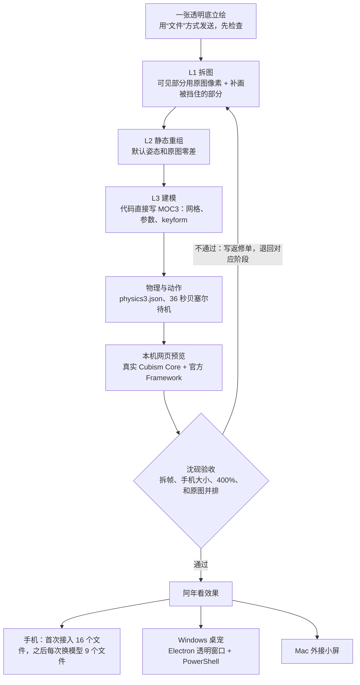

# 纯 AI 做 Live2D：从一张图到手机和桌宠

> 文中的 `work/…`、`docs/plans/…`、`ASTRA_HANDOFF.md`、android-body、desk-companion 等路径指原始私有项目，里面含原画和模型，没有公开；这里只公开方法。
> 本文根据本仓库和两个相关项目（手机身子 android-body、电脑陪玩 desk-companion）在 2026-10-21 至 2026-11-04 的真实记录整理而成，不是理想化教程。做对的、做错的、返工的都写进来了。
> 数字都来自记录、代码，或者对仓库文件的复算。记录没写清的地方，标为“（记录里没写清：…）”。
> 人物：**阿年**（提供原画、拍板、在真机上试用）；**沈砚**（Claude Opus 5.5，写施工单、验收、装机上线）；**Astra**（GPT 6 Astra，运行在 Codex 桌面版里，承担主要施工）。

---

## 新手先看：第一次别走的歪路

我们自己踩过这些坑，每一条都让整轮工作白做。

1. **原图要用“文件”方式发送，必须是透明底 PNG；收到后第一件事就是检查它。** 用聊天软件按“照片”发送，图会被压成 JPG，透明背景变成黑色，分辨率也会变低。后面抠细发丝、做半透明边缘，全靠原图的 alpha 通道（透明度通道）。alpha 一旦丢了，就再也找不回来。我们拿一张被压过的黑底 JPG 连做了 V1、V2 两版，边缘的黑灰毛边一直修不干净（见第 1 节）。
2. **已经有定稿立绘时，不要让 AI 把每个部件重画一遍。** 逐件生成的部件，轮廓、笔触、光影、神态没法同时对上原图，拼起来就是另一张脸（r04 失败，见第 3 节）。看得见的部分直接用原图像素，只有被挡住、动起来才会露出的地方才补画。
3. **默认姿态和原图做零差对比，这是硬门槛。** 修隐藏件时只要动了看得见的像素，就会越改越坏（r06、r07）。每次交付都附上差值数字。
4. **下游不许替上游打补丁。** 建模时发现耳根没画够，要退回拆图那一步补画，不能把网格拉长去遮住。
5. **检查时用运行端真实会同时写入的参数组合。** 单个参数都没问题，说话时几个参数一起变才露出的缝，我们就碰到过（见第 7 节“左眉灰线”）。
6. **一定要在真机上、按实际显示大小看。** 本机浏览器能跑，不等于手机能跑；Mac 上的 mock 通过，也不等于 Windows 能跑。只看 400% 放大图，会把判断带偏。
7. **只有 Live2D Core、没有官方 Framework 时，物理不会生效。** 头发、耳朵的惯性要靠 Framework 里的 Physics 来计算。
8. **找问题是验收方的工作，不能等用户用出问题。** 交付时写清楚已验了什么、没验什么；没有全部测过，就不说“好了”。

---

## 0. 全貌

### 0.1 总流程



### 0.2 实际走过的版本

| 日期 | 版本 | 发生了什么 |
|---|---|---|
| 10-21 | V1 | 用黑底 JPG 硬拆，25 层，12 个参数，没有物理 |
| 10-25 | V1 装上手机 | 手机黑屏（待机动作还没加载完就开始绘制），已修 |
| 10-26~27 | V2 r3 | 加嘴形、眉毛、高光，头发分 6 个区并接上官方物理，左右耳可以分开摸；阿年确认 |
| 10-29 | V2 装上手机 | H 窗口实际装机；真机上很难看：“眼睛裂开、耳朵也是”；查出根因是原图被压成了 JPG |
| 10-29 22:30 | V5 重做 | 按博主的做法分窗口重做（L1→L5→装手机） |
| 10-29~30 | L1 r01–r08-r2 | 先原图提取，再改成逐件 AI 重画（失败），再回到“原图优先 + 补画”；r08-r2 于 10-30 14:25 通过 |
| 10-30 | r1→r3 | 建模、打装机包，两轮修动态问题；17:5x 装上手机 |
| 10-30 | r4→r4d | 闭眼、戳脸反应、待机幅度；22:4x 装上手机 |
| 10-31 | 小屏 | 同一个 r4d 模型显示在 Mac 外接的 1280×720 小屏上 |
| 11-04 | 桌宠 v5 | Windows 透明桌宠，按住侧键说话；23:16 全链路在真机上跑通 |

### 0.3 分工（按阶段和授权变化）

| 阶段 | 阿年 | Astra | 沈砚 |
|---|---|---|---|
| V1（10-21） | 指定由 Astra 制作 | 施工 | 未参与（施工单由家里另一位助手写，并负责验收交付） |
| V2（10-26~27） | 后半程直接带着 Astra 改，最后确认 | 施工 | 写细调单和 PLAYBOOK |
| 手机接入 H 窗口（10-29） | 授权 | **获授权实际装机**：v8-h-live2d-20261029-r3，通过 USB 逐个读回 16 个文件，SHA 全部一致 | 写接入单 |
| V5 模型 L1–r4d（10-29~30） | 看图拍板，中途纠正方向 | 施工；**单子明确禁止自己往手机发送** | 写施工单和返修单，验收，装机（r3、r4d） |
| 桌宠 v5（11-04） | 在 Windows 上试用 | 调研，第 2–6 步施工（只用 mock） | 选路，部署 VPS 和隧道，打开真实接口，在 Windows 现场排错 |

10-30 起阿年定了一条规矩：做 Live2D 时沈砚只验收、提意见，不自己动手画（为了省额度）。

### 0.4 时间与成本

- 从决定重做（10-29 22:30）到新模型装上手机（10-30 17:5x），**经过的时间**大约 19 小时；到 r4d 装机又过了大约 5 小时。这是这一次的时间线，**不是工时，也不承诺复现时能这么快**。中间有休息、等待、阿年上班。
- Astra 用的是阿年的 ChatGPT 额度。10-30 起额度紧张，除 Live2D 外所有项目都暂停了。**没买新东西不等于没有成本**：额度、人等待的时间、反复看图的精力，都是成本。返工是其中最大的一块：L1 一天之内交了七版。
- 没有购买 Cubism Editor、VTube Studio 或绑模服务。桌宠用的云接口（OpenRouter 转写和识图、MiniMax 语音合成）用的是现有账号。（记录里没写清：这些接口具体花了多少钱。）

### 0.5 需要准备什么

见第 13 节“最小可执行路径”中的依赖清单。

---

## 1. 第 0 步：拿到真正的原图，并检查清楚

**目标**：拿到没有压缩、带透明通道的原图；记录它的 SHA-256；之后任何步骤都不许改它。

**用什么**：`ffprobe` 或 Pillow，`shasum -a 256`，NumPy（统计 alpha 分布）。

**怎么做**
1. 请对方用“文件”方式发送（Telegram 里是点回形针→文件），不要选“照片”。
2. 收到后先查四件事：是不是 PNG；模式是不是 RGBA；尺寸多大；**alpha 分布**（0、255、中间值各有多少像素）。
3. 把图放进 `input/`，SHA-256 写进 `input/PROVENANCE.md`，测试里加一条“input 不可变”。

**要抠的细节**
- **光检查“是 RGBA、四个角是透明的”不够。** 我们的原图（1086×1448）复算结果是：完全透明的像素有 504,739 个，alpha=255 的只有 534 个，其余 1,067,255 个都是中间值，其中绝大多数在 252–254 之间（253 一档就有 727,193 个）。也就是说，**人物主体内部本身就不是完全不透明的**。
  这件事有两个后果：一是叠层以后，透明度和接缝会受它影响；二是不能随手把内部 alpha 都改成 255。r05 就是因为把内部 252/253 归一化成了 255，结果和原图的 alpha 最大差了 16。后来专门做了 SourceOpacity 来还原原图的透明度（见第 4 节）。
- 原图宽或高低于约 1000px 时，拆出来的虹膜只有十几二十个像素，眼神细节会受限制。V2 时虹膜约 26×15px，高光只有 2–4 个原始像素。

**踩过的坑**
- 10-21 到 10-29 这段时间，V1 和 V2 用的都是被 Telegram 压成 960×1280 黑底 JPG 的图。黑底去不干净，黑色眼线和头顶发圈被当成背景误删，细发丝只能收边约 1px，找不回原来的 alpha。10-29 22:20 阿年用“文件”方式重发，才拿到真正的 RGBA 1086×1448 原图。

**怎么验收**：`PROVENANCE.md` 里有 SHA；模式是 RGBA；记录了 alpha 分布；四个角真的是透明的。

---

## 2. 把参考资料整理成文档，需要时可以回查

**目标**：把参考资料（博主视频、教程）拆解成文字，以后的施工单都引用这份文档。我们的版本是 `docs/LIVE2D-PLAYBOOK.md`。

**怎么做**：把参考的每一步拆成表格（做了什么、画面里能看到哪些细节）；写清工具链的限制、自己踩过的坑、“模型问题还是渲染问题”的排查表、参数命名规范和验收清单。

**要抠的细节**
- 博主的关键做法是：**先让 AI 生成一张“为了拆件而画”的原图**，然后拆成 42 层（头发约 15 片，虹膜单独一层）。我们是拿一张现成的定稿立绘来硬拆。这两条路的起点不一样，后面的做法也要跟着变（见第 3 节）。
- 平时以文档为准，不凭印象说话；10-29 就因为凭印象把“博主让 AI 做”说成了“画师一层层画”。**但文档不是封印**：文档前后矛盾、缺了某一帧、或者遇到文档里没有的新问题时，要回原始资料去看。r4c 闭眼的改进，就是因为专门去看了一段动态 CG 里闭眼的那几秒才得到的。

---

## 3. L1 拆图：最要紧的一步

**目标**：把原图拆成可以单独动的部件，产出 PNG、坐标、遮挡蒙版和 PSD。**默认姿态拼回去要和原图完全一致**；被挡住、动起来才会露出的地方，要补画完整。

**用什么**：Python 配 Pillow、NumPy、OpenCV、psd-tools；补画用 Codex 环境内置的 ImageGen；博主 skill 里的 `references/artwork.md`。

### 3.1 走过的路：r01 → r08-r2

| 版本 | 做法 | 结果 |
|---|---|---|
| r01 | 原图提取 + 隐藏部分补画，54 层 | Astra 自检就没通过：眼白层混进了虹膜，脸底残留眼镜和发丝，镜框断断续续，几束头发有断片，耳根补画不合格。根因是同一张完整眼睛图被同时当成眼白和虹膜的底图 |
| r02 | 同一路线，继续修 | 修到一半（虹膜散点问题，见 3.3），10-29 16:01 收到沈砚的指令：“立刻停止 r02 的原图抠像素路线”，改成逐件生成 |
| r03/r04 | 每个部件单独让 ImageGen 重画；10-30 00:00 又写成硬规定“禁止抠原图像素” | r04 交了 56 层，失败：整体横截面宽度在 y=50 处多出 9.92%，在 y=500 处多出 14.99%；右眼开口偏窄；“画风和神态仍不像原图”；还出现过整张脸被误生成、方形瞳孔 |
| r05 | 10-30 07:34 阿年纠正：**优先抠图，取不到的嘴内、耳根等才补画** | 默认态可见区域 RGB 差为 0（alpha 差见 3.4）；但单层上问题很多 |
| r06/r07 | 修隐藏件时动了看得见的像素 | 越改越坏：眼睛像在翻白眼，脖子出现裂缝，头发轮廓边上飘着碎片。作废 |
| r08 | 回到 r05 做底，默认态可见像素一个都不许动 | 整张 RGBA 零差；嘴通过，眼睛不通过 |
| r08-r2 | 修好眼睛的 9 项问题 + 牙边 | 14:25 通过 |

**怎么理解这段历史**：r01/r02 失败是执行上的问题（混层、残留、断片），不能说明“抠原图这条路走不通”。真正证明走不通的，是 r04 那条“定稿立绘逐件重画”的路。

### 3.2 最终做法（r05 → r08-r2）
1. **看得见的部分直接用原图像素**，按部件分配。皮肤和细线混在一起的半透明边缘，用“反求 alpha / 前景色”的方法拆开。
2. **被挡住的部分才补画**：耳根（要画长，伸进头发下面）、耳后头皮和后发底、口腔（深色 + 上牙 + 舌）、刘海下面的额头、闭眼皮、头发后面的衣服。**绝对不能用生成图替换看得见的脸。**
3. 画布用原图的 2 倍整数倍（2172×2896）。**放大方式是整数像素复制**，不是平滑重采样（见 3.5），也不代表多出了细节。
4. 部件：r05 有 57 层，r08 有 65 层。脸部光影单独一层；左右侧发因为被镜框遮挡，另外有 `HairSideUnderL/R` 深度片，和同侧发束绑定在一起。

### 3.3 要抠的细节
- **低透明度散点会把自动裁切框撑大。** 生成的 PNG 在透明区里有一些 alpha 极低的散点，自动裁切会把它们算进虹膜的边界，缩放以后圆形就歪了（10-29 r02）。正确做法：先找出主体的有效连通区域，再确定裁切框，同时保留抗锯齿边缘。**不要只用 `getbbox()`，也不要一刀切掉所有半透明像素。**
- **脸部光影层不能把别的部件的影子烘焙进去**，否则镜框一动，脸上就留下一副“幽灵眼镜”（r05 第 1 条）。
- **半透明边缘要干净**，不能留下反求 alpha 产生的灰白闪点（r05 第 2 条）。
- **眼白必须完整连续，不能有洞**；**虹膜要完整**：瞳孔是圆的，被上眼睑盖住的部分也要补全（r05 第 3、4 条）。
- **闭眼补丁要压在刘海下面**，形状沿着眼眶走，不能有直角硬边（r06 第 1 条）。
- **闭眼线要用原图上睫毛的像素往下弯**，保留原来的粗细变化、颜色和收尖（r07 第 2 条）。
- **牙齿**画成一条柔和的白色弧带，用极淡的竖线暗示 4–6 颗牙，不要画成锯齿尖牙（r07 第 3 条）。
- 左右眼本来就不对称，按各自的形状做，不要做成镜像。

### 3.4 分层数据长什么样
每一层记录：纹理 PNG、在全局画布上的偏移（x, y）、宽高、绘制顺序 `order`、默认是否可见 `visible`，以及**它自己的遮挡蒙版**（蒙版有独立的 x/y，不一定等于部件的裁切框）。匿名示例见第 13 节。

- **默认遮挡蒙版不能直接烘焙进纹理。** 记录里的原话是：“neutral occlusion; bind reveal to occluder movement, not a permanent cutout”。被挡住的部分会随着遮挡物移动而露出来，不是永久的缺口。
- 眼眶蒙版要保留自己的坐标和完整范围，不能按虹膜 PNG 的大小裁切，也不能跟着虹膜一起动。
- **比较时要说清在比什么。** r05 的 `static-composite-native.png` 和原图相比：可见区域 RGB 差为 0，alpha 最大差 16（复算）；r08、r08-r2 整张 RGBA 差为 0。“原像素分配后直接重组”“加上补画后合成”“PSD 合成”是三个不同的结果，要分开报告。
- **PSD 只能证明可以编辑、图层完整，不能作为零差的依据。** PSD 重新打开后，图层、位置、蒙版都对，但它的合并预览带有白底预乘和 8 位量化误差，和零差 PNG 不会逐字节相同。**零差以 PNG 为准。**

### 3.5 素材保真、隐藏件抗锯齿、显示缩放：三件事分开处理
- **素材保真**：最终路线保留整数像素复制。r06 时要求过“2 倍放大要平滑重采样”，这条后来作废了，因为平滑重采样会改动受保护的像素。
- **隐藏件抗锯齿**：只对动起来才露出的部件单独处理。例如 r4d 只给闭眼线边界做了约 0.9 个原生像素的抗锯齿，没有对整张图做模糊。
- **显示缩放**：交给渲染器处理。纹理用 NEAREST 采样，配合至少 2 倍超采样和 MSAA（见第 6 节）。试过全局改用 LINEAR 过滤，结果出现层间接缝，没有采用。

### 3.6 怎么验收
- 默认拼合（原生尺寸和 2 倍尺寸）和原图逐像素做差，RGBA 最大差为 0。
- 每种状态的改动只出现在应该出现的区域里。
- **把每一层单独铺在灰底上放大看**，不能只看拼合图。r05 验收单的第一句话就是：“默认拼合等于原图，这不算本事。”
- 最后请人来判断“是不是他”。

---

## 4. L2/L3 建模：用代码直接写 MOC3

**目标**：不用 Cubism Editor，直接产出 Core 能加载的 `.moc3`，以及 `model3.json`、纹理、`physics3.json`、`idle.motion3.json`、`cdi3.json`、`parameters.json`。

### 4.1 写 MOC3 的概念清单
1. **库快照**：用博主 skill 附带的 MIT 许可序列化器 `py-moc3` 的固定快照。项目代码会修改这个快照的 section 顺序：把第 41 和 44 项、第 82 和 83 项互换（代码注释写的是“这个固定快照有两处字段顺序错误”）。**这两处互换只适用于这一个快照**，换了版本必须重新核对，不能照抄。
2. **文件头与画布**：本项目设 `header.version=4`，`pixels_per_unit=1000`，原点在 (480, 640)，画布 960×1280；顶点坐标写成 `(像素 - 原点) / 1000`。原图坐标 1086×1448 要按 `960/1086` 换算。
3. **纹理与 UV**：所有部件拼进一张 4096×4096 的图集；UV 等于图集中的像素位置除以 4096。每块四周留 2px 边缘延伸，透明像素的 RGB 用最近的不透明颜色填上，防止采样时把黑边带进来。
4. **网格**：按部件形状布点。嘴沿唇线布点，眼、眉布得密，大块布得疏；完全透明的格子不生成三角形。
5. **参数与 keyform**：每个网格只绑定它需要的参数轴。keyform 是这些轴所有取值的笛卡尔积，展开顺序必须和 binding band 的顺序一致。参数、keyform、位置数组的 `begin_indices` 和 `counts`（偏移量和数量）必须逐项对上。轴越多，组合数增长越快。
6. **蒙版索引**：虹膜和高光以同侧的眼白为蒙版，写进 `drawable_mask` 索引。
7. **加载检查**：用真实的 Core 加载，逐个检查每个参数确实带动了网格、数值都是有限值、组合姿态没有问题。我们用 Node 加载 Core 5.1 跑 `check_rig.cjs`，和浏览器检查是两份独立的证据。

### 4.2 要抠的细节
- **参数用 Live2D 标准名**：`ParamAngleX/Y/Z`、`ParamEyeLOpen/ROpen`、`ParamEyeLSmile/RSmile`、`ParamEyeBallX/Y`、`ParamBrowLY/RY`、`ParamMouthOpenY`、`ParamMouthForm`、`ParamBreath`。自定义参数：`ParamEarL/R`（耳朵，物理输出）、`ParamEarTouchL/R`（摸耳输入）、`ParamHairFrontL/C/R`、`ParamHairSideL/R`、`ParamHairBack`。**L/R 指的是角色自己的左右**，和画面上的左右相反。最终一共 24 个参数。标准名方便以后接 VTS，但**不能代替在 VTS 上实测**。
- **眨眼时不能压扁虹膜**，要用眼眶蒙版把它遮住。
- **眼睛的“互补份额”拆分**：原来的眼睛拆成外层和 OpenEyeInside 两份互补的 alpha，静止时两份拼回去和原样一致；眼珠一动，里面那份就淡出，旧虹膜不会留下残影。**不要退回“开口>0 就裁掉”的二值做法**，那样会出现锯齿白缝。
- **半眨眼的绑定要单独修。** 修过的问题有：半眨眼时眼线和眼皮脱开、转眼时旧虹膜残影、上牙不跟着头动、耳根扭裂、长发被衣服的固定缺口截断。
- **接缝补底（Underlap，最终共 24 个）**：在发束、衣服、脖子等部件和遮挡它的头发之间，只开一条宽度不超过 12px 的窄缝补底，颜色取最近的不透明像素，边缘柔和渐变。补底片随所属部件一起变形，**静止时不改变原图（默认 RGBA 改动为 0）**。
- **长发压在衣服上的 Surface 分片**：r05 的静止裁切把“长发穿过衣服”的前后关系隐藏掉了。如果长发留在衣服后面，发梢一动就会被衣服上那个旧形状的缺口截断。所以把这些长发自己的像素单独拆成 Surface 片，放到衣服前面。
- **SourceOpacity：还原原图透明度的修正层。**
  - 它存的不是原图的轮廓，而是“**原图 alpha 和分层合成后 alpha 的比值**”：`coverage = round(原 alpha / 分层合成 alpha × 255)`，合成 alpha 为 0 的地方填 255。实测范围是 239–255，**没有 0**。
  - 正因为没有 0，它不会把移出旧轮廓的耳朵、头发裁掉。反过来，如果把它做成轮廓遮罩，就会裁掉。
  - 渲染时放在**最后一步**，用 `gl.blendFuncSeparate(ZERO, SRC_ALPHA, ZERO, SRC_ALPHA)` 乘上去。画布是预乘 alpha 的，所以 RGB 和 alpha **要一起**乘同一个系数，颜色和透明度才能保持一致；只乘 alpha 会让半透明边缘发亮。
  - 在标准 MOC 里它的不透明度是 0，普通 SDK 会直接忽略这个辅助网格。**零差依赖定制的渲染器。**
- **说实话**：GPU 默认输出的不透明区域 RGB 差为 0，alpha 差为 0；但半透明像素储存的颜色会受预乘量化影响，所以不能说成“GPU 输出整张 RGBA 零差”。
- **没有 `.cmo3`**：这只意味着不能当作 Cubism Editor 工程来编辑。以后仍然可以通过素材和构建代码长期修改。只有明确需要 Editor 工程时，才要另外请绑模师或重新做一份。

### 4.3 踩过的坑
- 加载成功但画面空白：渲染器没有处理 Core 的 Y 轴和 UV 翻转（V1）。
- 测试绑定了旧模型的哈希，结果拿旧证据通过了新模型。测试必须拒绝和当前文件对不上的证据。
- 耳尖贴着画布边缘，大角度转头时被裁掉。

### 4.4 怎么验收
- Core 能加载；每个参数推到最大、最小都能看到变化。
- 组合检查：r08-r2 跑了 36 组，r3 跑了 94 组，r4 起跑 121 组。
- **明确的验收点**：眼睛开合在 0、0.3、0.5、0.65、1 各看一次；单眼闭合；转头的同时张嘴；转头的同时说话。

---

## 5. 物理、待机、口型、戳脸

**用什么**：官方 Cubism Web Framework 5-r.2 中的 `CubismModel`、`CubismMotion` + `CubismMotionQueueManager`、`CubismPhysics`。

1. **物理**：physics3.json 一共 8 组。6 组头发由 AngleX（65% 位移）和 AngleZ（35% 角度）驱动；2 组耳朵**各自只读** `ParamEarTouchL/R`。发根固定，发梢摆幅最大。
2. **待机**：36 秒一个循环，用受限贝塞尔曲线，3.5 秒过渡加停留；眨眼间隔不固定；呼吸幅度轻；视线偶尔有小变化。**待机曲线里不写头发和耳朵**。另外在第 12 秒、第 27 秒分别给左右耳一个很小的输入脉冲。
3. **每帧顺序固定**（代码见第 13 节）：`dt` 上限 0.1 秒；页面切回前台时重新稳定物理；物理的输出不能再当作下一帧的输入。
4. **摸耳**：给对应输入一个平滑脉冲：0.5 秒升到峰值，1.3 秒回到 0；耳朵大约 0.45 秒展开，2–3 秒回稳。不要直接写物理输出 `ParamEarL/R`。
5. **口型**（音量驱动，不做音素识别）：
   ```js
   const target = Math.min(0.85, Math.max(0, (rms - 0.012) * 4.5));
   mouth += (target - mouth) * (1 - Math.exp(-dt / (target > mouth ? 0.035 : 0.075)));
   set('ParamMouthOpenY', mouth);
   set('ParamMouthForm', 0.4 * mouth / 0.85);
   set('ParamEyeLSmile', 0.08 * mouth / 0.85);
   set('ParamEyeRSmile', 0.08 * mouth / 0.85);
   ```
   - **RMS 的来源**：如果能拿到实际播放的音频节点，就把它接到 `AnalyserNode`（fftSize=1024），每帧读时域数据算 RMS。如果拿不到（比如手机原生播放），就把同一段 MP3 在页面里解码，按 20ms 一块预先算好包络，再用“播放位置 = 上报的位置 + (现在 - 上报时刻)”去查表。
   - **清零**：没在播放、静音、闭眼、播放结束、取消、解码失败、页面隐藏时，`OpenY / Form / 两个 Smile` 全部归零。
6. **戳脸反应**（r4）：施加在参数上的峰值大约是 **AngleX/Y 合计 10、AngleZ 3（这些是参数值，不是角度）**，用阻尼弹簧在 1 秒内回正。在形变实现里，AngleZ 还要乘 0.12 才是旋转角度，所以 3 实际约等于 0.36°；X/Y 是用来近似视差的平移，不是真正的三维旋转。同时眨一次眼、两只耳朵轻抖一下，靠物理带动头发甩起来。连续戳的时候，最小间隔 250ms，冲击要合并，不能越叠越大。
7. **待机幅度**（r4）：头部晃动加到原来的约 2 倍，呼吸 0.9，每隔 8–20 秒随机往一边瞟一眼。不额外开 RAF、定时器或服务。

**要抠的细节**：只有 Core、没有 Framework 时，物理和贝塞尔动作都不会生效（V1 手机端就是这样）。Framework 5-r.2 里必须调用 `motion.setEffectIds(...)`，否则播放时会报错。

**踩过的坑**
- V2 第一次交付，阿年说“几乎看不出区别”：录屏只截了待机最开始的 4 秒，而且幅度设得太小。
- 嘴“像割开一条缝”：整条闭嘴线都分给了上唇。修法是按原图的唇线接触曲线把上下唇拆开，嘴角共用。
- 摸一只耳朵，头发也跟着动：原来的“轻戳”是给所有物理组同一阵风。修法是左右耳各用一个独立输入。
- 转头时像在扯脖子：脖子上端只少量跟随，下端和衣领固定不动。
- 口型至今还不够满意：r4d 之后阿年说嘴“动了但粗糙”，以后单独开一张单子处理。

---

## 6. 本机预览和录像

**用什么**：`python3 -m http.server`（只绑定 127.0.0.1）、预览页（每个参数一个滑块，加复位、深浅底切换）、Playwright 驱动 Chromium、ffmpeg。

- **按手机实际大小看**：600×1000 视口下的整个人物，然后再看 400% 放大，两种都要和原图并排对照。只看 4 倍放大图会把判断带偏：放大图只说明“原图放大后就是这样”，不能证明一定要换原稿。
- **画质**：开启 MSAA；按 2 倍空间采样渲染，最后只缩小一次；纹理在图集里按 1:1 放置。录像从 PNG 帧直接一次编码成 H.264，另外附一张无损静帧。之前出现过“录像糊”，原因是预览没开 MSAA，录像还被转码了两次。
- 本机录像的帧率（比如 27.52fps）**不能代表手机上的性能**。

---

## 7. 动态验收：静态零差不等于动起来没问题

**沈砚的做法**
1. 把 40 秒预览视频拆成每秒 1 帧（第二轮改成每秒 2 帧），从头看到尾。
2. 把说话帧、转头帧放大 4 倍，和原图并排对比。
3. 每个问题都给出坐标（原生坐标和 2 倍坐标），写明怀疑是哪一层出了问题，并写清**不许用什么办法修**（比如“不许靠盖头发去遮”）。
4. 要求重新录制，并单独截出这几帧：待机、说话、左转到底、右转到底、闭眼、闭眼说话。每一帧都要全身图，外加左眉、脖子、下颌三处的 400% 放大。

**抓到的三个动态问题（r1）**：左眉上方的头发里有一道浅灰色水平细线；转头时脖子轮廓滑到了蓝色领口上；转头时头发边缘有零星的白点和黑点。r2 修好了后两个，但**灰线在说话那一段（20.0–27.5 秒）每一帧都还在**。

**原因**：说话时运行端会同时写入 `ParamEyeLSmile/RSmile`（0.08×）和 `ParamMouthForm`（0.4×）。画面左侧的 `BrowR` 网格里包含原图的头发，`ParamEyeRSmile` 会把这整片挪开，露出下面浅色的接缝。r2 的静态“说话”检查漏掉了眼睛微笑这个输入。r3 只解除了这一个网格的附带联动，并用 94 组 Core 对比确认只有它发生了变化。

**闭眼前后改了五版**（每版按“输入问题 → 实际修改 → 剩下的问题”记录）

| 版本 | 输入的问题 | 实际修改 | 剩下的问题 |
|---|---|---|---|
| r4 | 阿年在真机上看，说“闭眼很奇怪”：线太黑太粗，补丁比周围亮 | 闭眼线改细到约 1.12 像素，皮肤补丁加阴影和羽化 | 线太细，手机大小下“整张脸像没有眼睛”；补丁太大、颜色太平 |
| r4b | 上一行 | 线中段 2.8 像素，两头收尖，外眼角带拖尾，沿原来的下眼缘走；补丁只盖住眼睛开口 | 线通过了；补丁里混进了头发的颜色，羽化后变成竖条纹；右眼外沿发红；半眨眼的边缘是白色锯齿 |
| r4c | 上一行，再加上阿年想要《代号鸢》动态 CG 那种闭眼层次，但脸和眼形要保持自己的 | 改成沿着眼皮平滑取色（去掉竖条色带），加入随闭眼一起移动的浅褶和柔和阴影 | 阿年反馈眼周的模糊范围太大，闭眼的黑边有锯齿 |
| r4d | 上一行 | 补丁上下沿往回收（上沿收 1.4 个原生像素，下沿收 1.2 个）；**补丁覆盖面积减少 12.05% / 11.45%**；**半透明柔化区域减少 42.43% / 42.13%**；黑边单独抗锯齿 | 阿年在真机上看：“这次真的好看了” |

**一句话标准**：手机大小下，一眼看上去是“这个人闭着眼睛”，而不是“眼睛被涂掉了”。

**测试要诚实**：19 个旧测试里有 2 个（镜框中心线、字幕过期）在没改动的原工程里本来就失败。每次都单独列出来，**不放宽断言**，也不写成“全部通过”。

---

## 8. 怎么给 agent 写施工单

### 8.1 原则：哪些写死，哪些写依据

我们最初总结的经验是“第一条把做法写死”。但**最大的一轮返工，恰恰就是写死了一个没被验证过的方法**（“全部 AI 重画，禁止抠像素”，见 3.1 的 r04）。所以修正如下：

- **必须写死的**：目标；保护对象（哪些像素、文件、行为不能动）；授权范围（能改哪些文件，能不能碰设备、服务器、钥匙）；验收标准（硬数字和要看的画面）。
- **方法要写，但要附上依据和失败后的处理**：比如“用原图像素做可见部分，因为逐件重画会变脸（r04 证据）；如果这样做不到，就停下来写清原因，提出两个可选方案交沈砚，不要自己换路线”。**还没验证过的方法不要冻结成铁律。**
- **措辞要防止被字面误读**：“不许变”要写清楚，是“验收时看像不像”，还是“不许动这些像素”。
- **区分两种“停”**：组内自检没通过，就接着修，不要停下来等确认（阿年 10-30 01:09 定的）；阶段验收没通过，下游就不能开工。调研类任务是例外：写完结论要停下来等选路（桌宠 v5 第 1 步就是这样）。
- 写完以后，逐句对照参考原文再核对一遍。

### 8.2 骨架（从 r4 开工单和桌宠 v5 施工单提炼）

```markdown
# <项目> 开工单 <版本> · <日期时间>

## 〇、边界（先读）
- 基线：以 <冻结目录/版本号> 为底；旧版本一律不许覆盖。
- 只许改：<文件/图层/参数，逐个列出>
- 保护：<默认态可见像素 / 已经通过的部件 / 已有手势和接口>
- 禁止：<碰设备、服务器、钥匙 / 自己往设备送>
- 方法：<做法>，依据：<证据>；做不通就停下，写出两个选项问 <验收方>，不要暗中换路线。
- 先读：<文档清单，精确到章节>

## 一、要做什么（逐条：现状 → 要改成什么 → 为什么，引用用户原话或真机反馈）

## 二、交付自查（自己先查，过不了不许交）
- 硬数字：默认态和原图 native/2x RGBA 最大差 0；GPU 不透明区域 RGB 差 0（附上数字）
- 画面：手机大小的整图 + 400% 局部，都和原图并排；列出必须截的帧
- 视频：40 秒，包含 <待机 / 眨眼 / 戳左脸 / 戳右脸 / 狂戳 3 秒 / 摸两只耳朵 / 说话>
- 测试：现有测试照常跑；原本就失败的单独列出，不许放宽断言
- 版本号 <...-rN>，输出到新目录；回滚基线 <rM>
- README 逐条对应第一节的每一条

## 三、不做 / 留给谁
```

### 8.3 交接规矩
- 下一步只能使用上一步冻结的文件，并附上 SHA 清单；上一步没通过验收，下一步不能开工。
- 哪一步出了问题就退回哪个窗口去改，**下游不许顺手修改上游**。
- 每个窗口只写自己的目录，以及交接文档里属于自己的那一段。
- agent 的上下文会被写满，所以要写断点文件，新窗口从断点接着做。

---

## 9. 怎么验收

1. **先做逐条对照表**：参考资料里的每一条，都和交付物逐一对上；没对完就不说“好了”，只说“还差哪几条”。
2. **自己核对，不轻信对方报的数字**。比如自己把参考图最近邻放大 2 倍，再和拼合图做差。
3. **先看手机实际大小，再看 400% 放大**，并且始终和原图并排看。
4. **动态效果要拆帧看**；用运行端真实会出现的参数组合来看（第 7 节）。
5. **证据要绑定哈希**：报告里写明实际加载的 MOC、纹理、动作、物理文件的 SHA。
6. **分清验到了哪一层**：能加载、能动、好看，是三个不同的层级。本机通过不等于手机通过，网页通过也不等于 VTS 通过。
7. **没有全部测过，就不说“好了”**；列出哪些已验、哪些未验。
8. 交付说明里不冒称别人已经读过、已经确认、已经装好。

---

## 10. 装进手机

### 10.1 首次接入和之后的模型更新是两套清单

**首次接入**（H 窗口，10-29）一共 **16 个文件**：
- 13 个模型/渲染文件：`face/face.js`、`face/live2d-v2.js`；`face/runtime/` 下 8 个文件；`face/vendor/cubism-framework.js`，以及它的 `version.json` 和 `LICENSE.json`。
- 另外 3 个文件用来接真实音频：电话页 `app.js`，手机代理 `agent.py`、`face_service.py`。

接入做了这些事：用官方 Framework 接管 Model、Motion、Physics；保留眼白和高光的 stencil 裁切以及透明混合；highp + MSAA，内部至少 2 倍采样后再缩放到页面大小。

**之后每次换模型**只需要 **9 个文件**：`face.js`（只改模型缓存号）、`live2d-v2.js`，加上 `runtime/` 下的 7 个文件。

### 10.2 要抠的细节
- **生命周期**：H 复现过一个问题：`pagehide` 时把进入浏览器返回缓存（bfcache）的模型释放掉了，用户返回后页面就无法继续。修法：判断 `event.persisted`。如果是进入返回缓存，只暂停、复位；只有真正离开页面才释放资源。切换模式时要防止重复加载 MOC、重复注册音频监听、同时开多个 RAF。测试里验证过“连续切换三次只加载 1 个 MOC”“降温时关掉 Live2D 并停掉原来的 RAF”。
- **更新包白名单**：Framework 的许可证一开始按 `.md` 打包，被更新器拒收了（`.md` 不在允许的后缀里）。后来把原文完整存成 `.LICENSE.json`，**没有扩大更新器的权限**。发布前要逐项检查路径、后缀、大小、SHA，以及许可证文件。**上传被接受不等于安装完成。**
- 外屏 L 形可用区要保持 960:1280 的比例，头顶留空，字幕不能压到脸，触摸坐标要随裁切一起换算。
- 闲置 5 分钟后切回小眼睛（防烧屏，这由界面层实现）；温度 ≥42℃ 时 Live2D 也要闭眼并停止渲染。
- 回滚时整套文件一起退，不能只退 MOC。

### 10.3 “应该读回什么”和“当时实际读回了什么”

| 装机 | 当时实际读回 | 没做的 |
|---|---|---|
| H r3（10-29） | installed / version / current_version / page_ready 四处一致；**通过 USB 逐个读回 16 个文件，SHA 全部一致**；确认 WebappActivity 在前台 | 外屏审美、真实声音、30 分钟发热 |
| r08-r2 r3（10-30 17:5x） | installed / current_version / page_ready 三处同版本 | **回滚基线没有在手机上实际读回**（人在工位，没有 USB），只是推断 |
| r4d（10-30 22:4x） | state=installed、version / current_version / page_ready 同版本 | 没有记录逐文件读回哈希（记录里没写清） |

应该做到的标准是：版本状态 + 运行资源逐文件哈希都要读回。

### 10.4 踩过的坑
- V1 手机黑屏：待机动作还没就绪就开始绘制，RAF 停住了。修法是等所有资源都就绪后再画。
- 远程更新时 Shizuku 停了，第一次送包自动回滚。送包前要确认脸页在前台、处于空闲，并且 Shizuku 正在运行。
- r4d 第一次发送时报“keep the eyes page open and idle”，阿年重新打开页面后才通过。
- 口型的数据源：脸页一开始只能拿到“正在说话”这个状态，拿不到音频，H 当时如实标了 BLOCKED，没有用正弦波假装口型。后来电话音频从现有的输出 gain 分支接 Analyser；日常播放改为在脸页里解码同一段 MP3，按 20ms 算包络。
- 发热：10-30 刚打开 Live2D 时手机到了 40.6℃；30 分钟的温度和帧率对比至今没有完整数据（记录里没写清）。

---

## 11. 番外：Mac 外接小屏（10-31）

`dock-display/` 是一个 macOS 小程序，把 r4d 显示在 Wokyis 1280×720 小屏上，旁边配万圣节插画和聊天记录。**模型资源通过符号链接复用**，不需要重新做模型；但页面渲染、交互、资源服务这些仍然要按目标环境移植并验证。

---

## 12. Windows 透明桌宠（11-04）

**目标**：屏幕右下角站着 r4d 的沈砚。背景透明，窗口置顶，不挡游戏的点击；按住人物可以拖动，位置会被记住；说话时字幕显示在头顶，声音从这个窗口播放，嘴跟着动；按住鼠标侧键可以对他说话。

### 12.1 架构

```text
[Windows]
  start.bat → PowerShell 5.1 desk-overlay.ps1    截图、侧键钩子、录音(WinMM)、鉴权、长轮询、托盘、热键
      │  私有命名管道 --desk-pipe=<随机名>（传文字 + 音频字节）
      ▼
  Electron 45.2.2 (main.cjs)                     420×620 透明无边框置顶窗口，只负责显示、字幕、播放
      └─ app.js + r4d.js（从手机版 live2d-v2.js 移植）+ Core 5.1.0 + Framework 5-r.2

[VPS]  judge（鉴权、筛选、识图、转写、语音合成）→ entry（把话送进沈砚的会话）→ 沈砚回话 → 合成 MP3 → Windows 取回播放
```

- **复用的是模型资源，渲染代码是移植的。** 7 个模型文件只读复制，逐个核对 SHA；渲染、音频、交互的约定（`r4d.js`）是从手机版移植过来的：去掉了手机本地接口，保留嘴型参数和包络算法。这些都在 Windows 上重新验证过。
- 选 Electron 而不选“PowerShell + WPF + WebView2”，是因为 Astra 调研后认为：WebView2 透明宿主、WPF airspace、按人物轮廓穿透点击这三件事要组合起来，必须在 Windows 上实测才知道行不行；Electron 则有现成的透明窗口和 `setIgnoreMouseEvents(true,{forward:true})`。代价是包更大：ZIP 172,884,573 bytes，解压后 426,887,045 bytes。好处是阿年不用安装任何运行时。
- **人物以外的区域可以穿透点击**：根据光标所在位置的 alpha 判断（`gl.readPixels` 只读 1×1 像素，alpha>12 视为点到人物）。没有用实验性的 `setShape`，因为它会把头顶的字幕也一起裁掉。
- **安全设置**：开启 sandbox、contextIsolation，禁用 Node，拒绝所有权限请求，禁止页面跳转和弹窗；页面拿不到设备口令。
- **录音**：PowerShell 里用 `Add-Type` 内嵌 C#，P/Invoke 调用 `winmm.dll` 的 `waveIn*`；格式为 16kHz、单声道、PCM16 WAV；最长 30 秒，超时只发送一次。
- **转写**：OpenRouter，先用 `google/gemini-2.5-flash-lite`，失败时用 `google/gemini-2.5-flash` 兜底，每次最多 8 秒；从松开按键起算，总期限 20 秒。空白、纯数字、纯时间戳当作噪音丢弃。语音单独计数，每小时 60 次。

### 12.2 交付前就已复现并修好的问题（Mac 上 mock 阶段）
- **socket 超时不能限制总耗时**：`timeout` 只管“多久没收到数据”。如果服务器一点一点慢慢回数据，总时长会超过 8 秒、20 秒的预算。修法：主请求和兜底请求都放在有绝对截止时间的传输线程里，到时间就取消并 shutdown。验证方式：用本机假服务器慢速返回数据（测试 `test_slow_trickle_has_a_wall_deadline`，先红后绿）。
- **请求取消后，HTTPConnection 可能自动重连**，已经过期的请求还是会发出去。修法：关闭自动重连（`auto_open=0`），并加一条确定性的竞态回归测试（`test_cancelled_transport_cannot_auto_reconnect`）。验证标准是取消之后不能再有任何请求发出。
- **120 字字幕看起来显示出来了，其实最后一行被裁掉了**，还和“在听…”的提示重叠。修法：逐步缩小字号直到全文放得下，超长内容分页显示；测试里用 `scrollHeight <= clientHeight` 检查全文可见，看截图时也确认不重叠。

### 12.3 Windows 现场踩过的坑（11-04 晚，沈砚和阿年在真机上）

| # | 现象 | 原因 | 怎么解决 |
|---|---|---|---|
| 1 | 安装包没下载完，只留下一个 `.zip.wxdownload` | 用微信内置浏览器下载，中途就停了 | 换正经浏览器下载；在家里局域网直接从 Mac 下载，比绕出去走隧道快很多 |
| 2 | PowerShell 报溢出 | Windows PowerShell 5.1 中 `[Math]::Max(0, double)` 选中了 Int32 重载；计时起点是 `DateTime.MinValue` 时就会溢出 | 参数一律写成 `[double]` |
| 3 | 单实例锁不可靠，第二次启动时静默退出 | 依赖 Mutex 构造函数的 `[ref]` 输出参数 | 改用 `WaitOne(0)` 判断；捕获 `AbandonedMutexException` 时当作已拿到锁；已有实例在运行时弹窗提示 |
| 4 | 桌宠启动后悄悄退出，消息也丢了 | 由 PowerShell 启动 Electron 时，主进程在 Windows 上拿不到可用的 stdin（一启动就被关闭） | 改用私有命名管道：`NamedPipeServerStream` 随机命名，通过 `--desk-pipe=<名字>` 传给 Electron |
| 5 | 拖动时窗口越拖越大 | 屏幕缩放 125% 时，`win.setPosition` 每次调用都会让窗口变大 | 改用 `setBounds` 并固定宽高，同时设置最小和最大尺寸 |
| 6 | 发过去的“替换文件”没有生效 | 通过 Telegram 发送的替换文件，在 Windows 上被存成了 `desk-overlay(2).ps1`；还有人把 `.ps1` 打成 `.psl` | 改成一行更新命令：`iex (iwr <局域网地址>/go.txt -useb).Content`。它会停掉旧进程、下载最新文件、删除 `(2)` 副本、重启程序，并上传一份诊断报告（系统版本、进程、屏幕、网络、隐藏口令后的配置、各日志尾部） |
| 7 | VPS 上的服务突然死掉 | 服务是从沈砚自己的 shell 里启动的，和沈砚的服务在同一个 cgroup，沈砚的服务一重启就被一起杀掉 | 改用 crontab `* * * * *` + `flock` 保活 |
| 8 | 侧键上下反了 | 鼠标驱动软件自定义了侧键，XBUTTON1 和 XBUTTON2 对调了 | 在配置里对调 `side_button` 和 `voice_button` |
| 9 | 按住说话时提示“超时” | 服务端只在沈砚会话空闲时才送入语音；沈砚正忙的话，20 秒的窗口就过期了 | 设计上的缺口，还没改 |
| 10 | 截图“直看”总是失败 | 识图模型把 JSON 包在 ```json 代码块里，而且描述超过 40 字，结果每张都被丢弃 | 解析前去掉代码块标记；描述超长时截断，不再整张丢弃 |
| 11 | 没有声音 | Windows 的默认输出设备是一副没人戴的耳机 | 改回正确的输出设备 |

**提醒**：这些 Windows 现场修复，Astra 原来的测试都没有覆盖到（原测试用的是 Electron API 的 mock，Mac 上也没法跑 Windows PowerShell），以后回归测试要补上。

### 12.4 怎么验收
按 `win/阿年试跑步骤.md` 第二节的表格逐项试。每一项都写了“应该看到什么”和“不对时截哪里”。11-04 23:16，全链路在阿年的 Windows 上实测通过。

---

## 13. 最小可执行路径

不需要公开角色原画，也能按这个顺序复现。

### 13.1 依赖
- Python 3 虚拟环境：attrs 26.1.0、numpy 2.5.4、opencv-python-headless 5.0.0.93、pillow 13.0.0、psd-tools 1.25.0（`requirements.lock`）。
- MOC3 序列化器：`py-moc3`（MIT）固定快照。注意 4.1 第 1 条提到的 section 顺序问题。
- Live2D Cubism Core（专有，需要自己从官网下载；本文验证用的是 5.1.0）。
- Cubism Web Framework 5-r.2（固定提交 `e3c4ba18…`），用 esbuild 打包成单文件。
- Node + Playwright（用于浏览器检查和录屏）、ffmpeg。
- 图像生成工具（只用来补画被挡住的部分）。

### 13.2 顺序（概念流程）
```text
0. 检查原图：PNG / RGBA / 尺寸 / alpha 分布，记录 SHA，设为只读
1. 拆层脚本：原图 → 部件 PNG + 遮挡蒙版 + layout.json + PSD + 静态拼合
2. 零差检查：静态拼合 vs 原图（native/2x RGBA 最大差 0）；单层灰底放大检查
3. 补画隐藏件：只补遮挡下的区域，记录提示词和 SHA，并重跑第 2 步
4. 建模脚本 --static：静态 MOC3 → 用 Core 加载 → 默认渲染 = 拼合图
5. 建模脚本：逐组加入参数（眼 → 嘴 → 眉 → 头 → 身体 → 头发 → 耳）、physics3、idle；每组留一个可回退版本
6. Core 检查：每个参数都起作用、组合姿态数值有限、左右耳互不影响
7. 浏览器预览：真实 Core + Framework，原图并排、滑块、复位；跑极值和组合截图
8. 录 40 秒视频 → 拆帧 → 手机大小 + 400% 和原图并排验收
9. 打包运行包（模型资源 + 渲染器 + 许可证），写版本号和回滚基线
```
本仓库对应的命令见 `README.md`“复建与验证”和 `work/v5/DELIVERY-README.md`“从源包重建”。

### 13.3 分层清单示例（匿名，字段名和真实构建一致）
```json
{
  "version": "example-L1",
  "width": 2048, "height": 2048,
  "coordinate_origin": "top-left",
  "side_convention": "L/R are screen sides, map to character sides in L3",
  "source": {"path": "reference.png", "sha256": "<sha256>", "width": 1024, "height": 1024},
  "resolution_note": "Exact 2x pixel replication for shared canvas",
  "draw_order": "ascending order; apply every layer mask",
  "coverage_mask": "masks/source-opacity.png",
  "layers": [
    {"name": "HairBack", "texture": "parts/01-HairBack.png",
     "x": 600, "y": 200, "width": 800, "height": 1100, "order": 1, "visible": true,
     "mask": {"texture": "masks/HairBack-neutral-occlusion.png", "x": 600, "y": 200,
              "purpose": "neutral occlusion; bind reveal to occluder movement, not a permanent cutout"}},
    {"name": "EyeWhiteL", "texture": "parts/20-EyeWhiteL.png",
     "x": 880, "y": 680, "width": 120, "height": 60, "order": 20, "visible": true},
    {"name": "ClosedEyeL", "texture": "parts/31-ClosedEyeL.png",
     "x": 870, "y": 690, "width": 140, "height": 30, "order": 31, "visible": false}
  ]
}
```
要点：坐标都在全局画布上；`visible:false` 表示默认隐藏的动作件（闭眼、口腔）；蒙版有自己的 x/y，不一定等于部件的裁切框。

### 13.4 每帧渲染顺序
```js
function frame(dt) {
  dt = Math.min(dt, 0.1);
  model.loadParameters();                        // 1. 恢复基础参数
  motionManager.updateMotion(model, dt);         // 2. 待机动作（贝塞尔）
  applyHeadGazeBlink();                          // 3. 外部头部 / 视线 / 眨眼 / 戳脸
  applyMouthFromAudio(dt); applyEarTouch(dt);    // 4. 口型与表情、摸耳输入
  physics.evaluate(model, dt);                   // 5. 物理（输出不回灌）
  model.update();                                // 6. Core 更新
  drawMeshes();                                  // 7. 普通网格
  drawSourceOpacityLast();                       // 8. 如果有修正层：ZERO,SRC_ALPHA 一起乘 RGB 和 alpha
}
```

---

## 14. 许可和版权

- **Live2D Cubism Core**：专有运行库。本仓库和模型交付 ZIP 都不包含它，需要按官方条款自己下载（<https://www.live2d.com/en/sdk/download/web/>）。验证版本为 5.1.0，SHA `25ae938c…792f`。
- **Cubism Web Framework 5-r.2**：Live2D Open Software License，许可证随源码一起保留。
- **py-moc3**：MIT 许可，许可证保留在 `vendor/py-moc3/LICENSE`。它的许可不代表 Live2D SDK 或 Core 的许可。
- **博主的 skill**：只参考了流程和格式说明，没有复制或打包其中未明确授权的示例源码。
- **博主视频**：只在本机用于研究，不放进仓库，也不放进交付包。
- **原画**：由阿年提供，只用于私人制作和测试，不授予公开再发布或商用的权利。
- **不是官方产物**：这是实验性的直接 MOC3 构造，没有 `.cmo3`，不代表 Live2D 或 VTube Studio 的官方认证。
- **一处差异**：Windows 桌宠的安装包里随包带了 Core 和它的许可证文件（只在阿年自己的电脑上使用），这和模型交付“不再分发 Core”的做法不同。（记录里没写清：Live2D 对再分发 Core 和商业发布的具体条件。要公开分发或商用，请自己去读 Live2D 官方的许可和发布条款。）

---

## 15. 最该记住的十条

1. 原图用“文件”方式发送、透明 PNG；收到后先检查，包括 alpha 分布。
2. 参考资料整理成文档，平时以文档为准；文档矛盾或缺内容时，回原始资料去查。
3. 已有定稿立绘时：可见部分用原图像素，只补画被挡住的部分。
4. 默认态零差是硬门槛，并且要说清楚在和什么比；零差以 PNG 为准，不以 PSD 为准。
5. 单层铺灰底看、拆帧看、按手机大小看、400% 放大看。
6. 只有 Core 就没有物理；每帧的计算顺序是固定的。
7. 检查时用运行端真实会出现的参数组合。
8. 施工单写死目标、保护对象、授权和验收标准；方法要附依据，并写清做不到时怎么办。
9. 原本就失败的测试单独列出，绝不放宽断言；没全测不说“好了”；说清楚当时实际读回了什么。
10. Mac 上的 mock 通过不等于 Windows 通过；准备好一键更新和诊断回传。

## 附：仓库内文件索引

| 想看什么 | 在哪里 |
|---|---|
| 博主做法拆解、参数规范、验收清单 | `docs/LIVE2D-PLAYBOOK.md` |
| 补画提示词 | `docs/IMAGEGEN.md` |
| 物理、口型、摸耳的代码和接入说明 | `docs/V2-CHANGES.md`、`docs/V2-INTEGRATION.md` |
| 各版施工单 | `docs/plans/*.md`、`work/v5/BRIEF-*.md` |
| 验收单 | `work/v5/L1/*/REVIEW-*.md`、`work/v5/delivery/REVIEW-*.md`、`work/v5/L2/preinstall-repair/REVIEW-*.md` |
| 施工交接 | `ASTRA_HANDOFF.md`、`PROJECT_STATUS.md`、`work/v5/CONTINUE-*.md` |
| 建模代码 | `src/build_model.py`、`work/v5/L2/build_r08.py` |
| 当前手机版本 r4d | `work/v5/delivery-r4d/` |

（大文件、录屏证据、`work/` 下的中间产物、Core 运行库和博主视频不在 GitHub 仓库里。手机接入和桌宠的记录分别在 android-body 和 desk-companion 两个仓库。）
