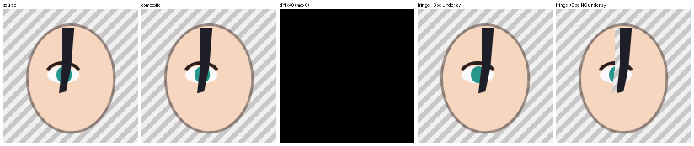

# 可运行的小例子：拆件、补底、零差重组

用一张程序画出来的 160×160 小图，把[教程第 1 步“拆图”](../../docs/01-教程.md#1-拆图)里的几个关键原理完整跑一遍。不用任何角色素材，也不需要 Live2D 运行库。

## 演示了什么

1. **透明原图**：一张有抗锯齿边缘的脸、一圈半透明描边、一只眼睛（眼白、虹膜、上睫毛线），再加一缕压在眼睛上的刘海。脚本运行时会把这张图存为 `source.png`。
2. **用原图像素拆件**：脸、眼白、虹膜、上睫毛、刘海这几个部件，都是把原图的像素按“作者画的蒙版”分出来的，没有重新画。虹膜带一张眼眶蒙版 `EyeApertureL`，这张蒙版有自己的 x/y，范围也比虹膜的裁切框大。
3. **两个部件共享的半透明边缘**：刘海边缘的像素同时盖在脸或眼睛上。处理办法是“反求前景色”：已知刘海颜色 F 和刘海覆盖度 a，原像素颜色满足 C = F·a + B·(1−a)，由此解出底下的颜色 B。刘海拿 (F, a)，底下的部件拿 (B, 不透明)，叠回去正好得到 C。如果解出的 B 超出 0–255，就退回到“两层都用原色”的做法，脚本会统计退回了多少个像素。
4. **被挡住区域的补底**：刘海完全盖住的那块（向外扩 1px），单独放一层 `UnderlayFringe` 补底，压在最下面。默认姿态下它完全被盖住，不影响零差；刘海一动，它就露出来。这里的“补画”是用程序重画了一遍不带刘海的皮肤和眼睛，真实项目里一般用图像生成工具来补。
5. **分层清单 `layers.json`**：格式和教程里的示例一致，包括 L/R 的说明。部件名里的 L/R 指画面左右；`sdk_name` 字段写的是建模时要用的角色自己的左右。
6. **重组并断言零差**：从文件里读回各个部件，按绘制顺序叠起来，断言和原图相比 RGBA 最大差为 0，同时输出 `diff.png`。
7. **散点撑大裁切框**：做一块“生成出来的虹膜”，四个角上有 alpha=3 的几乎看不见的散点。脚本会把 `getbbox()` 得到的框，和“只取 alpha≥16 的最大连通区域，再外扩 2px 留出抗锯齿边”得到的框，一起打印出来对比。

## 怎么运行

需要 Python 3、Pillow 和 numpy（我们用 numpy 2.5.0、Pillow 12.2.0 测过），不用装别的东西。

```sh
python3 split_demo.py
```

输出都写到 `output/` 目录：`source.png`、`layers/*.png`、`masks/*.png`、`layers.json`、`composite.png`、`diff.png`、`contact-sheet.png`。

## 预期输出

```text
source.png: 160x160 RGBA, alpha 0/255/partial = 14480/9693/1427
parts: 6 (incl. 1 hidden underlay); shared edge pixels unmixed: 103, fallback: 0
recomposite vs source: RGBA max diff = 0
fringe moved 6px: holes inside opaque face without underlay = 461, with underlay = 0
scatter pitfall: getbbox() = (2, 1, 46, 47)  vs  main-component box = (12, 14, 33, 35)
OK
```

`contact-sheet.png` 从左到右依次是：原图 | 重组 | 差异（放大 40 倍，全黑表示 0） | 刘海右移 6px（有补底） | 刘海右移 6px（没有补底，能看到洞）。



## 这个例子没覆盖的

- 这里的重组用的是脚本里自己写的直通 alpha “over”运算，零差只针对这个运算成立。真实运行时 GPU 用的是预乘 alpha，半透明像素储存的颜色会有量化误差，见教程第 2 步的“如实描述结果”。
- 部件之间的硬边界（比如眼白和脸的交界）是按蒙版直接分的。如果要让虹膜真的转动起来，还需要教程第 2 步讲的眼眶遮罩和“互补份额”拆分。
- 蒙版用的是二值的。如果你用软蒙版，要按同样的思路把覆盖度分配好，否则重组就不再是零差。
